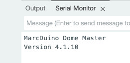
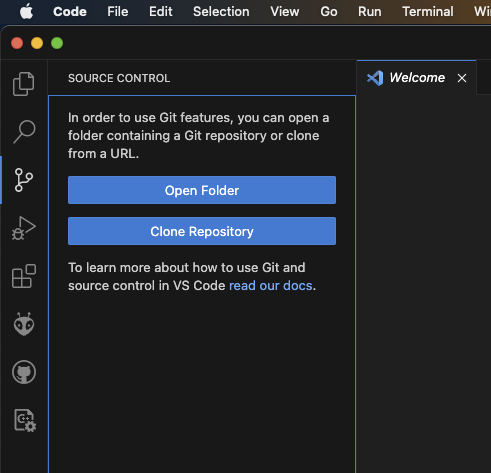
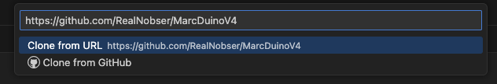
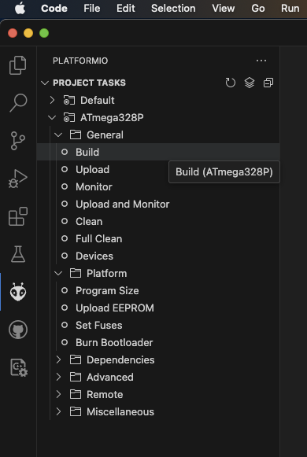
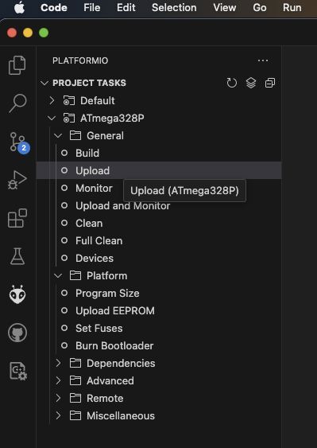
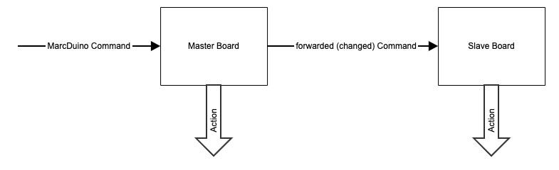

# BetterDuino Firmware V4

[English](README.md) | **Deutsch**

## Was ist das MarcDuino-System?
(von https://www.curiousmarc.com/r2-d2/marcduino-system):

"Das MarcDuino-System steuert die Animatronik eines R2 (Dome Panels, Licht und Sound). Derzeit steuert es 10 Dome Panels, ein "MP3 Trigger"-Soundboard, die "Teeces"-Lichter im Dome, Licht und Bewegung der Holoprojektoren sowie I2C-Gizmos, die man selbst ergänzen kann. Es bietet zahlreiche vorprogrammierte Effekte, bei denen all diese Komponenten zusammenspielen.

Im Mittelpunkt des Systems stehen die MarcDuino-Boards, die im R2 sitzen. Es gibt zwei Arten, das Master- und das Slave-Board, die einander sehr ähnlich sind." - CuriousMarc

## Was ist BetterDuino Firmware V4?
Die Software BetterDuinoFirmwareV4 ist ein **Firmware-Ersatz** für die originalen MarcDuino-V1.5Rev3-Boards.

Details zu den **Boards** gibt es hier:

https://www.curiousmarc.com/r2-d2/marcduino-system/marcduino-boards/marcduino-v1-5

https://astromech.net/forums/showthread.php?28414-Support-Thread-for-MarcDuino-v1-5-s

Die **Original-Firmware** gibt es hier:

https://www.curiousmarc.com/r2-d2/marcduino-system/marcduino-software-reference

Außerdem gibt es einen **Spinoff** von Marcs Firmware, bekannt als **MarcDuinoMain V3** und **MarcDuinoClient V3**:

https://github.com/nhutchison/MarcDuinoMain

https://github.com/nhutchison/MarcDuinoClient

## Wichtiger Hinweis
***BetterDuinoFirmwareV4 hat weder etwas mit der Original-Firmware von Marc noch mit dem Spinoff von Neil zu tun! Fragen zu BetterDuino Firmware V4 also bitte an keinen der beiden richten!***

***Gefundene Fehler bitte über den GitHub-Mechanismus "Issues" oben melden. Erfahrene Softwareentwickler sind herzlich eingeladen, Pull Requests einzureichen. Dies ist ein lebendiges Repository, und jeder Beitrag aus der Community ist willkommen!***

Bleiben Fragen offen, die hier nicht beantwortet werden, lohnt sich ein Besuch in Michael Baddeleys fantastischer Printed-Droid-Community: https://www.facebook.com/groups/MrBaddeley . Dort wird man fair und höflich behandelt, und gemeinsam findet sich eine Lösung oder Antwort auf die Fragen!

*Update:* Inzwischen gibt es auch einen BetterDuino-Support-Thread auf Astromech.net: https://astromech.net/forums/showthread.php?44309-MarcDuino-Replacement-Firmware

Trotzdem gilt: Lesen und verstehen, wie die Boards funktionieren, warum es ein Master- und ein Slave-Board gibt und wie die Boards miteinander verbunden sind:

https://www.curiousmarc.com/r2-d2/marcduino-system

https://astromech.net/forums/showthread.php?28414-Support-Thread-for-MarcDuino-v1-5-s

Sobald MarcDuino vertraut ist, hierher zurückkommen und weitermachen!

## Warum eine Ersatz-Firmware für MarcDuino-Boards?
Das letzte Update der Original-Firmware stammt aus dem Jahr 2018. Neils letztes Update war eine kleinere Änderung Mitte 2022. Seine V3-Software hat etwa 80 % des Original-Quellcodes gemeinsam und ergänzt einige Funktionen für die neuesten MarcDuino-Boards (Servo-Controller und EXT/AUX-Pin-Controller). Außerdem hat er die praktische Funktion ergänzt, Einstellungen zur Laufzeit im EEPROM zu speichern. Der Code hat aber auch einige Macken und Bugs und basiert auf veralteten Arduino-Bibliotheken. Ich habe 2023 begonnen, nachdem das gesamte Arduino-Framework und die Community in den vorangegangenen 5 Jahren wirklich große Fortschritte gemacht hatten.

Der Code der BetterDuino Firmware V4 wurde komplett von Grund auf neu geschrieben. Neils Idee der EEPROM-Speicherung habe ich einen Schritt weitergeführt, sodass nahezu ***jede*** Einstellung dort gespeichert wird, einschließlich Position und Geschwindigkeit pro Servo. Außerdem habe ich die neue Panel-Animation von Tim Hebel übernommen, der ebenfalls eine modifizierte MarcDuino-V3-Firmware verwendet (https://github.com/Eebel/SHADOW_MD_EEBEL).

### Neue Funktionen (Auszug)
- Unterstützung für MP3 Trigger, DF Mini Player, DY Player und R2-D2 / Astromech Vocalizer (https://humancyborgrelations.com/)
- Identische Firmware für Master, Slave und Body
- Automatische Konfiguration von Master und Slave beim ersten Start
- Laufzeiteinstellungen pro Servo für Offen-/Geschlossen-Positionen und Geschwindigkeit
- Modernes OOP-Softwaredesign und Verwendung der aktuellsten gängigen Arduino-Bibliotheken
- I2C-Slave-Modus: Jeder Befehl kann auch per I2C gesendet werden
- Unterstützung für R2-D2, Chopper (C1-10P) und BT-1
- Automatisierte Testsuite und Wokwi-Simulation (siehe [Entwicklung](#entwicklung))
- Zahlreiche Bugs behoben, zumindest die des V3-Spinoffs

## Los geht's
### Versionshistorie
| Datum | Rev | Firmware | Beschreibung |
|--|--|--|--|
| unveröffentlicht | main Branch | 4.4.6 (dev) | Bugfixes aus einem Security-/Robustheits-Review, Geschwindigkeit pro Servo für `:OP`/`:CL`, Holo-Move-Befehle, schlankerer Soundmodul-Code (ca. 700 Byte Flash und ca. 160 Byte RAM gespart), Testsuite und Wokwi-Simulation. Siehe [Aktueller Entwicklungsstand](#aktueller-entwicklungsstand-main-branch-unveröffentlicht) |
| 2025-08-10 | V1.4.5 | 4.4.5 | Konfigurierbares serielles Echo (`#EC`) für R2-Touch-Kompatibilität, DY Player im Standard-Release enthalten, Speicheroptimierungen |
| 2025-05-13 | V1.4.4 | 4.4.4 | Mehrere Bugfixes bei Sound- und Sequenzverarbeitung, Issue #9 behoben, DY Player als Option, Speicheroptimierungen |
| 2025-05-01 | V1.4.2 | 4.4.2 | Verbesserte Servo-Initialisierung |
| 2025-05-01 | V1.4.1 | 4.4.1 | Hotfix: ungewollter Servo-Impuls am Client |
| 2025-04-29 | V1.4.0 | 4.4.0 | Verbesserte Servo-Ansteuerung und Bugfixes |
| 2025-01-19 | V1.3.0 | | Unterstützung für Tiny MK4 Baddeley Dome Panels, Unterstützung für mehrere Body-Module |
| 2024-07-19 | V1.2.0 | | Neue Architektur, zusätzliche BT-1-Sequenzen |
| 2024-04-05 | V1.0.12 | | Zusätzliche BT-1-Sequenz |
| 2024-04-04 | V1.0.11 | | Sound-Hotfix |
| 2024-04-03 | V1.0.10 | | Korrekturen bei Zufallssounds, BT-1-Sequenz |
| 2024-03-20 | V1.0.9 | | EEPROM-Schutz, Brownout-Einstellung |
| 2024-03-20 | V1.0.8 | | Dome-Lift-Integration hinzugefügt |
| 2024-03-17 | V1.0.7 | | R2Touch-Keepalives entfernt, DFMini-Befehlssequenzen korrigiert |
| 2024-03-09 | V1.0.6 | | NeoPixelHolo-Konfiguration |
| 2024-03-08 | V1.0.5 | | NeoPixelHolo-Integration, Bugfix Servo 12/13 |
| 2024-01-30 | V1.0.4 | | Erste Chopper-Integration |
| 2024-01-17 | V1.0.3 | | Freie Panel-Positionierung in Panel-Sequenzen hinzugefügt: 0% = geschlossen / 100% = offen |
| 2024-01-15 | V1.0.2 | | Bugfix-Release |
| 2024-01-13 | V1.0.1 | | Klassischer I2C-Master und neuer I2C-Slave-Modus |
| 2023-12-30 | V1.0.0 | | Erste stabile öffentliche Version |
| 2023-12-11 | V0.9.1 RC | | Bugfixes aus der geschlossenen Beta-Testgruppe |
| 2023-10-23 | V0.9.0 RC1 | | Erste Version für die geschlossene Beta-Testgruppe |

### Aktueller Entwicklungsstand (main Branch, unveröffentlicht)
> Der `main`-Branch ist der Entwicklungsstand. **Für den eigenen Droid bitte ein offizielles Release verwenden:** https://github.com/RealNobser/BetterDuinoFirmwareV4/releases

Änderungen seit V1.4.5:

**Bugfixes (Abstürze und Speichersicherheit)**
- `:MV00` brachte Dome Master und Body Master zum Absturz (Null-Pointer). Auf dem Dome Slave führten auch `:MV00`…`:MV11` zum Absturz (der Slave hat nur die Panels 12/13).
- `*MV00` / `*MH00` (Holo-Move mit Holo-Nummer 0) brachten den Dome Slave zum Absturz.
- Befehle mit mehr als 21 Zeichen ließen einen internen Puffer überlaufen (Stack Overflow).
- War eine Zeile länger als der Eingabepuffer (23 Zeichen), wurde ihr Rest als eigener Befehl ausgeführt (z. B. ein in einem langen Displaytext verstecktes `#RS01`, also ein Werksreset). Der Rest einer überlangen Zeile wird jetzt verworfen.
- Callbacks bei Sequenzende: falscher Array-Index beim Löschen.
- Die Servo-Geschwindigkeit von Sequenzen war nach einem Soft-Reset nicht initialisiert (Panels konnten sich mit zufälliger Geschwindigkeit bewegen).
- `#HX00…` überschrieb die NeoPixel-Einstellung von Holo 3.
- Lange Timer liefen über: `*MO`/`*MF` über 32 s, `:EO`/`*EO` über 65 s.
- Ungültige Soundbänke/-nummern (z. B. `$0`, `$999`) spielten fremde Tracks ab; sie werden jetzt ignoriert.
- Nach Sequenzen ohne Panel-Bewegung (z. B. `:SE15`) blieb der Servo-Buzz-Schutz bis zur nächsten Panel-Sequenz deaktiviert.
- RGB-Holo-Builds: fehlende Prüfungen, wenn ein Holo als Standard-LED konfiguriert ist oder nicht genug RAM für den NeoPixel-Puffer vorhanden ist.

**Geändertes Verhalten**
- **Der I2C-Slave-Modus funktioniert jetzt tatsächlich.** Vorher wurden empfangene I2C-Daten stillschweigend verworfen (es war kein Receive-Handler registriert).
- `INCLUDE_HOLO_RGB` (NeoPixel-Build) deaktiviert jetzt auch den I2C-Slave-Modus (Flash-Größe, wie `INCLUDE_CLASSIC_I2C_SUPPORT`).
- `:OP`/`:CL` verwenden die mit `#SP` gespeicherte Geschwindigkeit pro Servo (Werkseinstellung 0 = volle Geschwindigkeit, d. h. unverändertes Verhalten, sofern keine Geschwindigkeit konfiguriert wurde). Sequenzen mit dem Geschwindigkeitsmodus "custom" verwenden sie ebenfalls.
- Neue Holo-Befehle `*MHxxdddd` / `*MVxxdddd` (Holo horizontal / vertikal bewegen).

**Speicher**
- Der Code für die Soundmodule (MP3 Trigger, DF-Player, DY-Player, Vocalizer) wurde zu einer einzigen Klasse ohne virtuelle Funktionen umgebaut: rund 700 Byte weniger Flash und rund 160 Byte weniger RAM, bei unveränderten seriellen Protokollen.
- Build-Flag `-mcall-prologues`: rund 1,2 KB weniger Flash.
- Alle Bugfixes zusammen kosten praktisch keinen Flash; der NeoPixel-Build ist insgesamt rund 2 KB kleiner (Sound-Umbau plus der dort nicht mehr enthaltene I2C-Slave-Modus).

**Entwicklung**
- Native Unit-Test-Suite (`pio test -e native`) und Wokwi-Simulation für alle drei Board-Rollen, siehe [Entwicklung](#entwicklung).

### Bekannte FEHLENDE Funktionen gegenüber dem Original-Quellcode
- RC-IN-Unterstützung (die Panel-Befehle `:RC`, `:HD` und der Holo-Befehl `*RC` sind nicht implementiert)

### Bekannte PROBLEME
- MP3-Trigger: Stoppen pausiert nur, Workaround ausstehend (Abspielen einer leeren Sounddatei).
- Nicht-numerische Parameter werden als 0 interpretiert, was meist "alle" bedeutet (z. B. öffnet `:OPxx` alle Panels). Das entspricht dem Verhalten der Original-MarcDuino-Firmware.
- Befehle an DF-Player und DY-Player blockieren das Board jeweils für ca. 100 ms (erforderliche Pause zwischen Befehlen dieser Module).
- Jeder Setup-Befehl (`#...`) schreibt sofort ins EEPROM. Setup-Befehle daher nicht in einer Schleife senden (die EEPROM-Lebensdauer beträgt etwa 100.000 Schreibzyklen pro Zelle).

### Unterstützte Boards
|Board|Unterstützung|Bemerkung|
|--|--|--|
|MarcDuino V1.5 Rev3|JA||
|MarcDuino V1.5 Rev2|JA|Servo 11 = Master AUX2<br>Servo 12 = Slave ML<br>Servo 13 = Slave AUX2<br>Magic Panel = Slave "To Slave"|
|Printed Droid AIO2.0|JA|Servo 11 = Master A2<br>Servo 12 = Slave ML<br>Servo 13 = Slave A2<br>Magic Panel = Slave2|
|Printed Droid BenDuino-Boards (https://www.printed-droid.com/kb/benduino-system/) | noch nicht, aber geplant, Tests ausstehend||
|MarcDuino V1 | **NEIN** ||
|MarcDuino V2 | **NEIN** ||

### Kompatibilitätsmatrix
|Master/Slave|1.8|3.x|4.x|
|--|--|--|--|
|1.8|JA|JA|JA|
|3.x|JA|JA|JA|
|4.x|JA|JA|JA|

### Firmware mit *.hex-Dateien hochladen
- Die neuesten Hex-Dateien aus dem GitHub-Repository herunterladen: https://github.com/RealNobser/BetterDuinoFirmwareV4/releases

	|Datei|Inhalt|
	|--|--|
	|BetterDuinoVxxx.hex|Master, Slave (Client) und Body. I2C-Slave-Modus. Dome-Lift-Port ist Master TX.|
	|BetterDuinoVxxx_DL_AUX.hex|Master, Slave (Client) und Body. Dome-Lift-Port ist Master AUX statt Master TX.|
	|BetterDuinoVxxx_Master+Client_ClassicI2C.hex|Master und Slave (Client), klassischer I2C-Master-Modus. Keine Dome-Lift-Unterstützung.|
	|BetterDuinoVxxx_NeoPixel.hex|Master und Slave (Client). NeoPixel-Unterstützung für die Holo-Lichter.|

	Vorgefertigte Dateien gibt es nur für R2-D2; andere vorgefertigte Hex-Binaries auf Anfrage.
- Die Hex-Datei mit den folgenden Fuse-Einstellungen flashen (**falsche Fuse-Einstellungen führen zu nicht funktionsfähigen Boards oder ungewolltem Zurücksetzen des EEPROM-Inhalts!**):

	* L: 0xFF
	* H: 0xD7
	* E: 0xFC

- **Empfohlen:** Wenn nicht die Arduino IDE verwendet wird, lohnt sich ein Blick auf avrdude
	* avrdude: https://github.com/MCUdude/avrdude
	* GUI für avrdude: https://blog.zakkemble.net/avrdudess-a-gui-for-avrdude/
	* einige Anleitungen: https://forum.arduino.cc/t/the-simplest-way-to-upload-a-compiled-hex-file-without-the-ide/401996

### Rollen zuweisen
Dieselbe BetterDuino-Firmware wird für MarcDuino Master, Slave und Body Master verwendet. Damit frisch geflashte MarcDuinos ihre Rolle kennen, muss sie jedem einzelnen zugewiesen werden.

Dazu eine Verbindung mit einem seriellen Monitor zum frisch geflashten MarcDuino herstellen. Dafür eignet sich der in die Arduino IDE integrierte serielle Monitor oder die [Serial Monitor Extension](https://marketplace.visualstudio.com/items?itemName=ms-vscode.vscode-serial-monitor) für Visual Studio Code.

Die Baudrate auf 9600 einstellen. Befehle müssen mit einem Carriage Return (CR, `\r`) abgeschlossen werden.

Beim Verbinden über das serielle Terminal sollte eine Begrüßungsmeldung ähnlich dieser erscheinen:



Zum Zuweisen der Rolle einen der folgenden Befehle eingeben:

* `#MD00` für MarcDuino Dome Master
* `#MD01` für MarcDuino Dome Slave
* `#MD02` für MarcDuino Body Master

Der MarcDuino startet sofort neu und läuft im neuen Modus hoch.

**Hinweis:** Die Voreinstellung nach einem Werksreset ist MarcDuino Dome Master. Ein am Slave-Port des MarcDuino Master angeschlossenes Board wird automatisch als Dome Slave konfiguriert. Ein Body Master muss entweder manuell oder über einen zusätzlichen Startbefehl `#MD02` konfiguriert werden, der nur an den Body-Controller gesendet wird.

## Entwicklung
### Entwicklungsumgebung
* Visual Studio Code: https://code.visualstudio.com/download
* PlatformIO Extension: https://platformio.org/install/ide?install=vscode
* Empfohlene ISP-Programmer:
	* https://www.diamex.de/dxshop/USB-ISP-Programmer-fuer-AVR-STM32-LPC-ESP32-8266-Prog-S
	* https://www.diamex.de/dxshop/USB-ISP-Programmer-fuer-Atmel-AVR

### Firmware mit Visual Studio Code bauen und hochladen
- Das GitHub-Repository mit Visual Studio Code klonen (Source Control / Clone Repository)
- 
- 
- Den lokalen Ordner öffnen
- Die Datei "platformio.ini" an den seriellen Port des eigenen Programmers anpassen:
`upload_port = /dev/cu.usbmodem141201` (Beispiel)
- Den Code bauen (PlatformIO / ATmega328P / General / Build)
- 
- Den Code hochladen (PlatformIO / ATmega328P / General / Upload)
- 

In VS Code baut der PlatformIO-Button **Build** die Firmware (Standard-Umgebung `ATmega328P`). Die `native*`-Umgebungen in der PlatformIO-Seitenleiste werden nur für die Unit-Tests verwendet.

Über die Kommandozeile:

```sh
pio run                      # Firmware bauen (.pio/build/ATmega328P/firmware.hex)
pio run -t upload            # per ISP-Programmer flashen (setzt auch die Fuses)
```

**Flash und RAM sind nahezu ausgeschöpft** (32 KB Flash, 2 KB RAM beim ATmega328P). Die Release-Builds verwenden die Standard-AVR-Toolchain von PlatformIO (GCC 7.3). Neuere Compiler erzeugen merklich größeren Code (GCC 9.5: ca. +1,2 KB). Der Build verwendet `-mcall-prologues` (siehe `platformio.ini`), das spart rund 1,2 KB, sodass die kombinierte Firmware auch mit neueren Compilern passt (GCC 9.5: 31.914 von 32.768 Byte). Auf Apple-Silicon-Macs ohne Rosetta läuft die AVR-Toolchain von PlatformIO nicht; stattdessen kann ein nativer avr-gcc (z. B. Homebrew `osx-cross/avr`) verwendet werden.

### Tests
Die Firmware-Quellen werden unverändert gegen Arduino-Mocks kompiliert und auf dem Host-Rechner ausgeführt, mit AddressSanitizer und UndefinedBehaviorSanitizer. Weder Hardware noch eine AVR-Toolchain werden benötigt.

```sh
pio test -e native                   # R2-D2
pio test -e native_chopper           # Chopper
pio test -e native_bt1               # BT-1
pio test -e native -f test_parser    # einzelne Test-Suite
```

Die Native-Tests benötigen einen C++-Compiler mit Sanitizer-Unterstützung auf dem Host-Rechner (clang unter macOS, gcc/clang unter Linux). Unter Windows die Tests in WSL ausführen; der Firmware-Build ist davon nicht betroffen.

Die Suites decken ab: Befehls-Parsing, den seriellen und den I2C-Eingangspfad, EEPROM-Speicherung und alle Setup-Befehle, den Sequencer, das Verhalten von Dome Master / Dome Slave / Body Master, alle vier Soundmodul-Protokolle, erschöpfende Befehls-Sweeps, zufälliges Fuzzing sowie alle Sequenznummern 0–99.

### Wokwi-Simulation
`sim/` enthält pro Board-Rolle (Dome Master, Dome Slave, Body Master) ein [Wokwi](https://wokwi.com)-Projekt mit Servos, LEDs und einem Logic Analyzer sowie automatisierte Szenarien, die die echte AVR-Firmware ausführen. Siehe [sim/README.md](sim/README.md).

```sh
pio run
export WOKWI_CLI_TOKEN=...           # https://wokwi.com/dashboard/ci
sim/run_scenarios.sh
```

### Compiler-Defines in include/config.h
Normalerweise müssen die Defines nicht geändert werden, für erfahrene Anwender aber einige Hinweise:
|Define|Funktion|Bemerkung|Standard|
|--|--|--|--|
|R2D2|baut die standardmäßige R2D2-MarcDuino-kompatible Firmware|Nur eines wählen: R2D2, CHOPPER oder BT1|an|
|CHOPPER|baut eine Chopper-kompatible Firmware|Nur eines wählen: R2D2, CHOPPER oder BT1|aus|
|BT1|baut eine BT-1-kompatible Firmware|Nur eines wählen: R2D2, CHOPPER oder BT1|aus|
|INCLUDE_DOME_MASTER / INCLUDE_DOME_SLAVE / INCLUDE_BODY_MASTER|in der kombinierten Firmware enthaltene Rollen|nicht benötigte Rollen deaktivieren, um Flash-Speicher zu sparen|an|
|DEBUG_MSG|aktiviert zusätzliche Debug-Meldungen am USB/Serial-Port|Programmgröße wird überschritten, nicht benötigte Rollen deaktivieren, um Platz zu schaffen|aus|
|INCLUDE_CLASSIC_I2C_SUPPORT|aktiviert die Unterstützung der klassischen MarcDuino-I2C-Befehle|deaktiviert die Body-Master-Rolle und den neuen I2C-Slave-Modus (Flash-Größe)|aus|
|INCLUDE_I2C_SLAVE|aktiviert die Unterstützung des neuen I2C-Slave-Modus|wird durch INCLUDE_CLASSIC_I2C_SUPPORT und INCLUDE_HOLO_RGB automatisch deaktiviert (Flash-Größe)|an|
|INCLUDE_HOLO_RGB|NeoPixel-Holoprojektoren|deaktiviert die Body-Master-Rolle und den I2C-Slave-Modus (Flash-Größe), ARDUINO_NEOPIXEL oder FASTLED_NEOPIXEL wählen|aus|
|SEPARATE_DOMELIFT|(Master-)AUX als separate serielle Dome-Lift-Schnittstelle verwenden||aus|
|INCLUDE_DY_PLAYER|Unterstützung für das Soundmodul DY-SV5W|ersetzt die DF-Player-Unterstützung|an|
|INCLUDE_HOLO_TEST|Holo-Bewegungstest-Befehl `*TExx`|zum Einrichten der Holo-Servos (ca. 370 Byte Flash)|an|

***Alle übrigen Defines bitte nicht verändern.***

Servo-Anschluss R2D2 (übliche Belegung)
=================
# Master
| **Servo** | **Funktion** | **Bemerkung** |
| --- | --- | --- |
|Servo 1|Panel 1|Unteres Panel|
|Servo 2|Panel 2|Unteres Panel|
|Servo 3|Panel 3|Unteres Panel|
|Servo 4|Panel 4|Unteres Panel|
|Servo 5|Panel 5|Unteres Panel|
|Servo 6|Panel 6|Unteres Panel|
|Servo 7|Panel 7|Oberes Panel|
|Servo 8|Panel 8|Oberes Panel|
|Servo 9|Panel 9|Oberes Panel|
|Servo 10|Panel 10|Oberes Panel|
|Servo 11|Panel 11|Rundes Top-Panel|
|AUX|unbenutzt||
# Slave
| **Servo** | **Funktion** | **Bemerkung** |
| --- | --- | --- |
|Servo 1|Front-Holo, V-Servo||
|Servo 2|Front-Holo, H-Servo||
|Servo 3|Rear-Holo, V-Servo||
|Servo 4|Rear-Holo, H-Servo||
|Servo 5|Top-Holo, V-Servo||
|Servo 6|Top-Holo, H-Servo||
|Servo 7|Front-Holo-Licht||
|Servo 8|Rear-Holo-Licht||
|Servo 9|Top-Holo-Licht||
|Servo 10=12|Tiny1|Tiny Lower Panel 1, nur Michael Baddeley Complex Dome MK4, wird über den Master als Servo 12 angesteuert|
|Servo 11=13|Tiny2|Tiny Lower Panel 2, nur Michael Baddeley Complex Dome MK4, wird über den Master als Servo 13 angesteuert|
|AUX|unbenutzt||
# Body
| **Servo** | **Funktion** | **Bemerkung** |
| --- | --- | --- |
|Servo 1|DPL - DataPanel-Tür||
|Servo 2|UtlArmU - Oberer Utility Arm||
|Servo 3|UtlArmL - Unterer Utility Arm||
|Servo 4|LBdyDr - Linke BreadPan-Tür||
|Servo 5|LArm - Linken Arm heben/senken||
|Servo 6|LArmTool - Werkzeug linker Arm||
|Servo 7|ToolRBdyDr - Rechte BreadPan-Tür||
|Servo 8|RArm - Rechten Arm heben/senken||
|Servo 9|RArmTool - Werkzeug rechter Arm||
|Servo 10|unbenutzt|Künftiger Servo für die Charge-Bay-Tür|
|Servo 11|unbenutzt||
|AUX|unbenutzt||

Servo-Anschluss Chopper (in Arbeit)
=================
# Master
| **Servo** | **Funktion** | **Bemerkung** |
| --- | --- | --- |
|Servo 1|Linke Dome-Tür||
|Servo 2|Linker Dome-Arm||
|Servo 3|Linker Dome-Greifer||
|Servo 4|Drehung linker Dome-Arm|Tim Hebel Mod|
|Servo 5|Rechte Dome-Tür||
|Servo 6|Rechter Dome-Arm||
|Servo 7|Rechter Dome-Greifer||
|Servo 8|Drehung rechter Dome-Arm|Tim Hebel Mod|
|Servo 9|Periskop heben||
|Servo 10|Periskop drehen||
|Servo 11|unbenutzt||
|AUX|Kamera aktivieren||

# Slave
| **Servo** | **Funktion** | **Bemerkung** |
| --- | --- | --- |
|Servo 1|||
|Servo 2|||
|Servo 3|||
|Servo 4|||
|Servo 5|||
|Servo 6|||
|Servo 7|||
|Servo 8|||
|Servo 9|Periskop-LED?||
|Servo 10=12|Antenne drehen|Wird über den Master als Servo 12 angesteuert|
|Servo 11=13|Antenne neigen|Wird über den Master als Servo 13 angesteuert|
|AUX|unbenutzt||

# Body
| **Servo** | **Funktion** | **Bemerkung** |
| --- | --- | --- |
|Servo 1|Dome neigen||
|Servo 2|Utility Arm||
|Servo 3|Utility-Arm-Greifer||
|Servo 4|Sägen-Tür||
|Servo 5|Sägen-Arm||
|Servo 6|Sägen-Motor||
|Servo 7|Interface-Tür||
|Servo 8|Interface-Arm||
|Servo 9|Interface-Aktion||
|Servo 10|||
|Servo 11|||
|AUX|||

Servo-Anschluss BT1
=================
# Master
| **Servo** | **Funktion** | **Bemerkung** |
| --- | --- | --- |
|Servo 1|Launcher 1|Linkes Launcher-Panel|
|Servo 2|Launcher 2|Rechtes Launcher-Panel|
|Servo 3|Raketen 1|Linke Raketen abfeuern|
|Servo 4|Raketen 2|Rechte Raketen abfeuern|
|Servo 5|unbenutzt||
|Servo 6|unbenutzt||
|Servo 7|unbenutzt||
|Servo 8|unbenutzt||
|Servo 9|unbenutzt||
|Servo 10|unbenutzt||
|Servo 11|unbenutzt||
|AUX|unbenutzt||
# Slave
| **Servo** | **Funktion** | **Bemerkung** |
| --- | --- | --- |
|Servo 1|Front-Holo, V-Servo||
|Servo 2|Front-Holo, H-Servo||
|Servo 3|unbenutzt||
|Servo 4|unbenutzt||
|Servo 5|unbenutzt||
|Servo 6|unbenutzt||
|Servo 7|Front-Holo-Licht||
|Servo 8|unbenutzt||
|Servo 9|unbenutzt||
|Servo 10=12|unbenutzt|Wird über den Master als Servo 12 angesteuert|
|Servo 11=13|unbenutzt|Wird über den Master als Servo 13 angesteuert|
|AUX|unbenutzt||
# Body
| **Servo** | **Funktion** | **Bemerkung** |
| --- | --- | --- |
|Servo 1|DPL - DataPanel-Tür||
|Servo 2|UtlArmU - Oberer Utility Arm||
|Servo 3|UtlArmL - Unterer Utility Arm||
|Servo 4|LBdyDr - Linke BreadPan-Tür||
|Servo 5|LArm - Linken Arm heben/senken||
|Servo 6|LArmTool - Werkzeug linker Arm||
|Servo 7|ToolRBdyDr - Rechte BreadPan-Tür||
|Servo 8|RArm - Rechten Arm heben/senken||
|Servo 9|RArmTool - Werkzeug rechter Arm||
|Servo 10|Charge-Bay-Tür||
|Servo 11|unbenutzt||
|AUX|unbenutzt||

MarcDuino-Befehlssatz (nur V4)
===============================

Nicht unterstützte Funktionen des originalen MarcDuino
=======================================

· keine RC_IN-Unterstützung für Panels/Servos

· einige Konfigurationsbefehle werden aufgrund der bereinigten Befehlsverarbeitung / Speicherung nicht unterstützt bzw. sind nicht nötig

Befehle
========

Routing
-------

Alle Befehle werden an das Master-Board gesendet. Das Slave-Board ist immer mit dem Master-Board verbunden. Slave-Boards laufen nicht im Stand-alone-Betrieb. Das Master-Board entscheidet also, was mit den Befehlen geschieht. Es kann den Befehl verarbeiten oder auch verwerfen.



Format
------

Jeder Befehl beginnt mit einem der unten aufgeführten Startzeichen und wird mit einem Carriage Return (`\r`) abgeschlossen. Eine Befehlszeile darf höchstens 23 Zeichen lang sein (plus `\r`); der Rest einer längeren Zeile wird verworfen. Line Feeds (`\n`) werden ignoriert.

Befehlsverarbeitung
------------------

| **Startzeichen** | **Funktion** | **Verarbeitung Master** | **Schnittstelle Master** | **Verarbeitung Slave** | **Schnittstelle Slave** | **Bemerkung** |
| --- | --- | --- | --- | --- | --- | --- |
| :   | Befehle für Pie Panels | VERARBEITET<br><br>AN SLAVE WEITERGELEITET P12/P13 | Servos<br><br>Serial_Slave | VERARBEITET | Servos | Slave ist nur für Panel 12/13 zuständig |
| *   | Befehle für Holoprojektoren (HP) | NICHT VERARBEITET<br><br>AN SLAVE WEITERGELEITET | Serial_Slave | VERARBEITET | Servos |     |
| @   | Display-Befehle | NICHT VERARBEITET<br><br>AN SLAVE WEITERGELEITET | Serial_Slave | VERARBEITET | Serial_Teeces |     |
| $   | Sound-Befehle | VERARBEITET<br><br>NICHT WEITERGELEITET | Serial_MP3 | NICHT VERFÜGBAR | -   |     |
| ! (Master) | Alt1: alternative Sound-Befehle, werden nach Entfernen des Startzeichens an Serial_MP3 übergeben | VERARBEITET<br><br>NICHT WEITERGELEITET | Serial_MP3 | NICHT VERFÜGBAR | -   |     |
| ! (Slave) | Alt1: alternative Display-Befehle, werden nach Entfernen des Startzeichens an Serial_Teeces übergeben | -   | -   | VERARBEITET | Serial_Teeces | Im Normalbetrieb fängt der Master-MarcDuino diese ab, daher kommen sie hier nicht an |
| %   | Alt2: alternative Befehle für das Holoprojektor-Board, werden ohne Entfernen des Startzeichens an Serial_Slave übergeben | NICHT VERARBEITET<br><br>AN SLAVE WEITERGELEITET | Serial_Slave | VERARBEITET | Serial_Magic | Slave entfernt das Startzeichen |
| #   | Setup-Befehle | VERARBEITET<br><br>AN SLAVE WEITERGELEITET | EEPROM<br><br>Serial_Slave | VERARBEITET | EEPROM | Der Befehl #MDxx (MarcDuino-Modus) wird nicht an den Slave weitergeleitet |
| &   | I2C-Befehle (nur klassischer I2C-Build) | VERARBEITET<br><br>AN SLAVE WEITERGELEITET | I2C<br><br>Serial_Slave | VERARBEITET | I2C |     |
| >   | Direkte Weiterleitung an den Slave | NICHT VERARBEITET<br><br>OHNE STARTZEICHEN AN SLAVE WEITERGELEITET | Serial_Slave | - | - | z. B. `>:OP12` |

Panel-Befehle
--------------

Sie müssen der Syntax ":CCxx\\r" folgen, wobei CC = Befehl, xx = zweistellige Dezimalzahl und \\r = Carriage Return.

`:OP`, `:CL` und `:MV` bewegen sich mit der mit `#SP` gespeicherten Geschwindigkeit pro Servo (Standard 0 = volle Geschwindigkeit).

| **Befehl** | **Funktion** | **Master** | **Slave** | **Bemerkung** |
| --- | --- | --- | --- | --- |
| :SExx | startet Sequenzen, siehe unten | JA | JA |     |
| :OPxx | öffnet Panel Nummer xx=01-13. Bei xx=00 werden alle Panels geöffnet (beim Slave nur 12/13) | JA | JA |     |
| :OP14 | öffnet die oberen Panels (7-11) | JA | NEIN  |  |
| :OP15 | öffnet die unteren Panels (1-6) | JA | NEIN  |  |
| :CLxx | schließt Panel Nummer xx=01-13. Bei xx=00 werden alle Panels geschlossen | JA | JA | :CL14 / :CL15 schließen obere / untere Panels |
| :LKxx | sperrt Panel Nummer xx=01-13, fixiert die aktuelle Position, um Probleme mit dem DomeLift zu vermeiden. Bei xx=00 werden alle Panels gesperrt (beim Slave nur 12/13) | JA | JA |     |
| :ULxx | entsperrt Panel Nummer xx=01-13, Normalbetrieb. Bei xx=00 werden alle Panels entsperrt (beim Slave nur 12/13) | JA | JA |     |
| :LIxx | Dome-Lift-Befehl xx, wird an den seriellen Dome-Lift-Port weitergeleitet. Siehe [Dome Lift](#anschluss-des-dome-lift-an-marcduino-boards) | JA | NEIN  |     |
| :STxx | Buzz Kill/Soft Hold: schaltet Servo xx ab, um Brummen zu vermeiden. xx=00 alle Servos aus. | JA | JA |     |
| :MVxxdddd | bewegt Panel xx=01-13 auf Position dddd, dddd=0000-0180 Grad, dddd > 0544 Mikrosekunden. Speichert die Position nicht. | JA | JA | Zur Panel-Justierung, siehe unten |
| :EOxx | AUX1-Ausgang, siehe [Besondere Funktionen](#besondere-funktionen) | JA | JA |     |
| :RCxx / :HDxx | RC-Steuerung / RC-Hold | NEIN | NEIN | nicht implementiert (keine RC-IN-Unterstützung) |

Details zu Sequenzbefehlen
------------------------

Siehe die in include/PanelSequences.h definierten Panel-Sequenzmatrizen (R2-D2-Nummerierung; Chopper und BT-1 verwenden eigene Sequenzen).

| **Befehl** | **Funktion** | **Bemerkung** |
| --- | --- | --- |
|     | **Komplett (Bewegung, Sound, Display…)** |     |
| :SE00 | Alle Panels schließen, Servos aus - nur zur Initialisierung verwenden. Für sanftes Schließen aller Panels CL00 verwenden. | Wird beim Start abgespielt, wenn `#SI01` (Standard) |
| :SE01 | Scream, mit allen Panels offen |     |
| :SE02 | Wave, ein Panel nach dem anderen |     |
| :SE03 | Schnelle Wave (Smirk) hin und her |     |
| :SE04 | Wave 2 (alle Panels nacheinander öffnen, dann einzeln schließen) |     |
| :SE05 | Beep Cantina (mit Marching-Ants-Panel-Aktion) |     |
| :SE06 | Faint/Short Circuit (Ohnmacht/Kurzschluss) |     |
| :SE07 | Cantina-Tanz (orchestral, rhythmischer Panel-Tanz) |     |
| :SE08 | Leia |     |
| :SE09 | Disco | ca. 6,5 Minuten |
| :SE10 | Reset in den Quiet Mode (Panels schließen, Holos stoppen, Sounds stoppen) |     |
| :SE11 | Reset in den Full Awake Mode (Panels schließen, Zufallssounds, Holo-Bewegung, keine Holo-Lichter) |     |
| :SE12 | Top-Panels auf RC | keine RC-IN-Unterstützung |
| :SE13 | Reset in den Mid Awake Mode (Panels schließen, Zufallssounds, Holos stoppen) |     |
| :SE14 | Reset in den Awake+ Mode (Panels schließen, Zufallssounds, Holo-Bewegung, Lichter an) |     |
| :SE15 | Screams ohne Panels |     |
| :SE16 | Panel Wiggle (Panels wackeln) |     |
|     | **Body-Sequenzen (Tim Hebel)** |     |
| :SE30 | Sequenz: Utility ARM öffnen und schließen |     |
| :SE31 | Sequenz: alle Body-Panels öffnen und schließen |     |
| :SE32 | Sequenz: alle Body-Türen öffnen und wackelnd schließen |     |
| :SE33 | Body - Greifer verwenden |     |
| :SE34 | Body - Interface-Tool verwenden |     |
| :SE35 | Body - Ping-Pong der Body-Türen |     |
| :SE36 | Body - BT-1-Sequenz mit zwei Greifern | Danke an David Steinke  |
|     | **Nur Panels bewegen** |     |
| :SE51 | Scream, mit allen Panels offen |     |
| :SE52 | Wave, ein Panel nach dem anderen |     |
| :SE53 | Schnelle Wave (Smirk) hin und her |     |
| :SE54 | Wave 2 (alle Panels nacheinander öffnen, dann einzeln schließen) |     |
| :SE55 | Marching Ants |     |
| :SE56 | Faint/Short Circuit (Ohnmacht/Kurzschluss) |     |
| :SE57 | Rhythmischer Panel-Tanz |     |
| :SE58 | Panel Wave Bye Bye (Panels winken zum Abschied) |     |

Holoprojektor-Befehle
-----------------------

Diese Befehle werden nur vom MarcDuino-Slave-Modul verarbeitet.

| **Befehl** | **Funktion** | **Bemerkung** |
| --- | --- | --- |
| *RDxx | Zufällige Holo-Bewegung (xx=01 bis 03). xx=00 und >3 alle zufällig. |     |
| *ONxx | Schaltet das Holo-Licht ein (xx=01 bis 03). xx=00 alle Lichter an |     |
| *OFxx | Schaltet die Holo-Lichter aus (xx=01 bis 03). xx=00 schaltet alle Lichter aus |     |
| *ONxxaaabbbcccddd | Schaltet das RGB-Holo-Licht ein (xx=01 bis 03). xx=00 alle Lichter an.<br>aaa - dezimaler R-Wert (0-255)<br>bbb - dezimaler G-Wert (0-255)<br>ccc - dezimaler B-Wert (0-255)<br>ddd - Helligkeit (0-255) | nur NeoPixel-Build |
| *COxxaaabbbcccddd | Setzt die Farbe des RGB-Holo-Lichts (xx=01 bis 03).<br>aaa - dezimaler R-Wert (0-255)<br>bbb - dezimaler G-Wert (0-255)<br>ccc - dezimaler B-Wert (0-255)<br>ddd - Helligkeit (0-255) | nur NeoPixel-Build |
| *MHxxdddd | Holo xx=01-03 horizontal auf Position dddd bewegen (0000-0180 Grad, > 0544 Mikrosekunden) | Neu |
| *MVxxdddd | Holo xx=01-03 vertikal auf Position dddd bewegen (0000-0180 Grad, > 0544 Mikrosekunden) | Neu |
| *TExx | Holo-Bewegungstest (xx=01-03). Durchläuft eine Schleife von Holo-Bewegungen als Hilfe beim mechanischen Justieren der Holo-Servos. | nur mit INCLUDE_HOLO_TEST |
| *STxx | Zufallsbewegung der Holos stoppen/zurücksetzen, schaltet die Lichter aus. 00=alle aus |     |
| *HDxx | Hold: Holo stoppen, Lichtzustand nicht ändern. 00=alle gestoppt |     |
| *MOxx | Magic Panel an. xx=01 bis 98: an für 1 bis 98 Sekunden.<br><br>· xx = 99 ist dauerhaft an<br><br>· xx = 00 ist aus |     |
| *MFxx | Magic Panel flackern: xx=1 bis 99 flackert 1 bis 99 Sekunden. 00= aus. |     |
| *H1xx<br><br>*H2xx<br><br>*H3xx<br><br>*H0xx | Schaltet die On-Board-HP1, 2, 3 bzw. alle (HP0xx) für xx Sekunden ein.<br><br>· xx = 99 ist dauerhaft an<br><br>· xx = 00 ist aus |     |
| *Hzxxaaabbbcccddd | Siehe "*H0"-"*H3"<br>aaa - dezimaler R-Wert (0-255)<br>bbb - dezimaler G-Wert (0-255)<br>ccc - dezimaler B-Wert (0-255)<br>ddd - Helligkeit (0-255)| nur NeoPixel-Build |
| *F1xx<br><br>*F2xx<br><br>*F3xx<br><br>*F0xx | Lässt die On-Board-HP1, 2, 3 bzw. alle (F0xx) für xx Sekunden flackern.<br><br>· xx = 99 ist dauerhaft an<br><br>· xx = 00 ist aus |     |
| *Fzxxaaabbbcccddd | Siehe "*F0"-"*F3"<br>aaa - dezimaler R-Wert (0-255)<br>bbb - dezimaler G-Wert (0-255)<br>ccc - dezimaler B-Wert (0-255)<br>ddd - Helligkeit (0-255) | nur NeoPixel-Build |
| *CHxx | Holo Nr. xx (01-03) zentrieren, xx=00 alle |     |
| *EOxx | AUX1-Ausgang am Slave, siehe [Besondere Funktionen](#besondere-funktionen) |     |
| *RCxx | Holo unter RC-Steuerung | nicht implementiert (keine RC-IN-Unterstützung) |

Sound-Befehle
--------------

Diese Befehle werden nur vom MarcDuino-Master-Modul verarbeitet.

| **Befehl** | **Funktion** | **Bemerkung** |
| --- | --- | --- |
| $xyy | Sound per Bank-/Soundnummer abspielen<br><br>· x=Banknummer (1-9)<br><br>· yy=Soundnummer (01-25) | Ungültige Bank-/Soundnummern werden ignoriert |
| $xy | Sound per Bank-/Soundnummer abspielen, Kurzform<br><br>· x=Banknummer (1-9)<br><br>· y=Soundnummer (1-9) |     |
| $x | Nächsten Sound von Bank x (1-9) abspielen |     |
| $R  | Zufallssounds aus Bank 1-5 |     |
| $O  | Sound aus |     |
| $L  | Leia-Nachricht (Bank 7, Sound 1) |     |
| $C  | Cantina-Musik (Bank 9, Sound 5) |     |
| $c  | Beep Cantina (Bank 9, Sound 1) |     |
| $S  | Scream (Bank 6, Sound 1) |     |
| $F  | Faint/Short Circuit (Bank 6, Sound 3) |     |
| $D  | Disco (Bank 9, Sound 6) |     |
| $s  | Sounds stoppen |     |
| $+  | Lautstärke erhöhen |     |
| $-  | Lautstärke verringern |     |
| $m  | Lautstärke mittel |     |
| $f  | Lautstärke maximal |     |
| $p  | Lautstärke minimal |     |
| $W  | Star-Wars-Musik (Bank 9, Sound 2) |     |
| $w  | Beep-Star-Wars-Musik (Bank 9, Sound 7) |     |
| $M  | Imperial March (Bank 9, Sound 3) |     |
| $i  | Beep Imperial March (Bank 9, Sound 8) |     |
| $B  | Startup-Sound |     |

Besondere Funktionen
----------------

| **Befehl** | **Funktion** | **Bemerkung** |
| --- | --- | --- |
| :EOxx | Setzt den Pin AUX1 auf High/Low. Kann z. B. zum Auslösen einer Nebelmaschine verwendet werden.<br><br>xx ist die Zeit in Sekunden.<br><br>· 00 - aus<br><br>· 01-98 ist die Zeit in Sekunden (für Nebelmaschinen keine Werte >10 verwenden!)<br><br>· 99 dauerhaft an (ebenfalls nicht für Nebelmaschinen verwenden) | wird nur auf dem MASTER ausgeführt |
| *EOxx<br><br>AN SLAVE | Setzt den Pin AUX1 auf High/Low. Kann z. B. zum Auslösen einer Nebelmaschine verwendet werden.<br><br>xx ist die Zeit in Sekunden.<br><br>· 00 - aus<br><br>· 01-98 ist die Zeit in Sekunden (für Nebelmaschinen keine Werte >10 verwenden!)<br><br>· 99 dauerhaft an (ebenfalls nicht für Nebelmaschinen verwenden) | wird nur auf dem SLAVE ausgeführt |

Setup-Befehle
--------------

Alle Setup-Befehle werden sofort im EEPROM gespeichert.

| **Befehl** | **Funktion** | **Bemerkung** |
| --- | --- | --- |
|     | **Servo-Steuerung** |     |
| #SOxxdddd | Grad/Mikrosekunden von Servo xx für Panel offen setzen, dddd=0000-0180 Grad, dddd > 0544 Mikrosekunden |     |
| #SCxxdddd | Grad/Mikrosekunden von Servo xx für Panel geschlossen setzen, dddd=0000-0180 Grad, dddd > 0544 Mikrosekunden |     |
| #SPxxddd | Geschwindigkeit von Servo xx setzen, ddd=0-255 (0 = volle Geschwindigkeit/Standard, 1 = am langsamsten ... 255 = am schnellsten). Wird von :OP, :CL, :MV und von Sequenzen mit Custom-Geschwindigkeit verwendet |     |
| #SWxx | Offen-&lt;-&gt;Geschlossen-Wert von Panel xx tauschen | Nicht als klassischen "Reverse Servo"-Befehl verwenden. Nicht bei jedem Start aufrufen, sondern nur während der Justierung verwenden. |
| #SIxx | Panel-Initialisierung beim Start<br><br>· #SI00 : aus<br><br>· #SI01 : beim Start :SE00 abspielen (alle Panels schließen) (Standard) | Master/Body |
|     | **Startup-Sound-Steuerung** |     |
| #SSxxx | Startup-Sound festlegen<br><br>· #SS000 : Startup-Sound deaktivieren und Startup-Sound-Verzögerung für schnellen Start des R2 entfernen<br><br>· #SSxxx : Startup-Sound auf Datei xxx setzen |     |
| #SQxx | Zufallssound deaktivieren<br><br>· #SQ00 : Zufallssound an<br><br>· #SQ01 : kein Zufallssound + Lautstärke aus<br><br>· #SQ02 : kein Zufallssound |     |
| #SXxx | Maximale Zufallspause in Sekunden setzen - maximale Zeitspanne zwischen zwei Zufallssounds |     |
| #SYxx | Minimale Zufallspause in Sekunden setzen - minimale Zeitspanne zwischen zwei Zufallssounds |     |
|     | **Systemkonfiguration und -verwaltung** |     |
| #MDxx | MarcDuino-Modus setzen<br><br>· #MD00 : MarcDuino Dome Master<br><br>· #MD01 : MarcDuino Dome Slave<br><br>· #MD02 : MarcDuino Body Master<br><br>Der MarcDuino startet nach dem Setzen sofort neu und läuft im neuen Modus hoch. |     |
| #MPxx | MP3-Player-Typ setzen<br><br>· #MP00 : SparkFun MP3 Trigger<br><br>· #MP01 : DFPlayer<br><br>· #MP02 : Vocalizer<br><br>· #MP03 : DY-Player | Startet sofort neu |
| #MSxyy | Maximale Anzahl Sounds pro Soundbank setzen. x=1-9 (Soundbank), y=0-25 (max. Sounds) |     |
| #RSET<br><br>#RS01 | MarcDuino neu starten<br><br>Werksreset |     |
| #ECxx | Serielles Echo aktivieren/deaktivieren<br><br>· #EC00 : serielles Echo aus<br><br>· #EC01 : serielles Echo an  | Nicht aktivieren, wenn ein Dome-Lift-Modul am TX-Port verwendet wird! |
| #DMxx | EEPROM-Wert an Adresse xx seriell ausgeben | nur DEBUG_MSG-Builds |
|     | **Holoprojektor-Konfiguration** |     |
| #HLxy | HoloLight x auf High-aktiv (y=1) oder Low-aktiv (y=0) setzen. x=0 → alle Holo-Lichter | Board anschließend zurücksetzen, damit die Änderung wirksam wird |
| #HNxy | HoloLight x auf NeoPixel (y=1) oder Standard-LED (y=0) setzen. x=0 → alle Holo-Lichter | Board anschließend zurücksetzen, damit die Änderung wirksam wird |
| #HXxxyy | Anzahl der LEDs (yy) für HoloLight xx=01-03 konfigurieren | Wird nur verwendet, wenn HoloLight xx auf NeoPixel gesetzt ist. Board anschließend zurücksetzen, damit die Änderung wirksam wird |
| #HOxxdddd | Maximalwert Grad/Mikrosekunden für Holo-HServo setzen, dddd=0000-0180 Grad, dddd > 0544 Mikrosekunden |     |
| #HCxxdddd | Minimalwert Grad/Mikrosekunden für Holo-HServo setzen, dddd=0000-0180 Grad, dddd > 0544 Mikrosekunden |     |
| #VOxxdddd | Maximalwert Grad/Mikrosekunden für Holo-VServo setzen, dddd=0000-0180 Grad, dddd > 0544 Mikrosekunden |     |
| #VCxxdddd | Minimalwert Grad/Mikrosekunden für Holo-VServo setzen, dddd=0000-0180 Grad, dddd > 0544 Mikrosekunden |     |
|     | **Nicht implementiert (aus älterer Dokumentation / Original-Firmware)** |     |
| #HPxxddd / #VPxxddd | Holo-Servo-Geschwindigkeit | nicht implementiert |
| #STxxx | Verzögerung zwischen Master- und Slave-Panel-Sequenz | nicht implementiert |
| #ADxx | Justiermodus | nicht implementiert, stattdessen :MVxxdddd verwenden |
| #DUxx | EEPROM ausgeben | ersetzt durch #DMxx (Debug-Builds) |

I2C-Befehle (klassisch, Master-Modus)
============
Nur im klassischen I2C-Build verfügbar (`INCLUDE_CLASSIC_I2C_SUPPORT`, Release-Datei `..._Master+Client_ClassicI2C.hex`).

**Quelle:**

https://www.curiousmarc.com/r2-d2/marcduino-system/marcduino-software-reference/marcduino-command-reference#h.p_EQOGPlR2RuOk

Wird ein Befehl im folgenden Format gesendet:

***&I2Caddress, data, data, data...**

so wird auf allen I2C-Ports der MarcDuino-Kette (Master und alle Slaves) ein I2C-Schreibbefehl erzeugt. Der Schreibbefehl ist an das Gerät mit der Adresse I2Caddress gerichtet und schreibt alle angegebenen Datenbytes der Reihe nach.

Die Daten können Dezimalzahlen, Hex-Bytes, Zeichen oder Strings sein, abhängig vom Präfix vor den Daten, wie folgt.

Dezimalzahlen benötigen kein Präfix. Der gültige Bereich ist -128 bis 255. Beispiel: Befehl 2 (dezimal) an ein I2C-Gerät mit Adresse 25 senden:

***&25,2**

Für ein Hex-Byte x als Präfix voranstellen. Hex-Byte 0xFF an Gerät 25 senden:

***&25,xFF***

Für ein einzelnes Zeichen das Präfix ' verwenden

***&25,'c***

Für einen String das Präfix " verwenden. Kein weiteres " ans Ende setzen, sonst wird es als Teil des Strings übertragen...

***&25,"Hello World  (Hinweis: am Ende des Strings steht kein zweites ")***

Und natürlich lässt sich alles kombinieren:

***&25,2,xFF,'c,"Hello World***

I2C-Befehle (neu, Slave-Modus)
==============================
MarcDuino-Boards mit BetterDuino-Firmware können jeden seriellen Befehl auch als I2C-Slave über die I2C-Schnittstelle empfangen. So können neben dem Hauptsteuerungssystem (ShadowMD usw.) auch andere Komponenten Befehle ausführen oder Sequenzen starten (z. B. Dome Lift). Das Protokoll ist ziemlich einfach: Eine I2C-Nachricht an eine der folgenden Slave-Adressen senden, deren Nutzdaten identisch mit einem der oben beschriebenen Befehle sind. Nicht vergessen, den Befehl mit einem Carriage Return (`\r` = 0x0D) abzuschließen. Ein Befehl pro I2C-Übertragung.

| **I2C-Adresse (dez/hex)** | **Typ** |
| --- | --- |
|50/0x32|MarcDuino Dome Master|
|51/0x33|MarcDuino Dome Slave|
|52/0x34|MarcDuino Body Master|

I2C-Adressen können bei Bedarf in include/config.h geändert werden.

Der I2C-Slave-Modus ist Teil des Standard-Builds (`INCLUDE_I2C_SLAVE`). Im klassischen I2C-Build und im NeoPixel-Build ist er nicht verfügbar. **Hinweis:** Bis einschließlich V1.4.5 wurden empfangene I2C-Daten verworfen (siehe [Aktueller Entwicklungsstand](#aktueller-entwicklungsstand-main-branch-unveröffentlicht)).


Panel-Justierung: Best Practice
==============================

- Eine serielle Schnittstelle an den Port "XBEE/SERIAL IN" des Boards anschließen
- Ein serielles Terminalprogramm öffnen und mit 9600 Baud, 8N1, Zeilenende CR verbinden. Im Terminalprogramm das Zeichenecho aktivieren.
- Mit dem Befehl "Move Panel" (:MVxxdddd) ein Gefühl für den Bewegungsbereich des Servos bekommen.
- Ist eine gültige Position für "offen" gefunden, diese mit dem Befehl "Store Open" (#SOxxdddd) speichern
- Ist eine gültige Position für "geschlossen" gefunden, diese mit dem Befehl "Store Closed" (#SCxxdddd) speichern
- Optional mit #SPxxddd eine Geschwindigkeit für das Panel setzen; sie wird von :OP, :CL und :MV verwendet

*Beispiel:*
- Bewegt ":MV010900" Panel/Servo #1 auf eine gültige Offen-Position, die Einstellung mit "#SO010900" speichern
- Bewegt ":MV011750" Panel/Servo #1 auf eine gültige Geschlossen-Position, die Einstellung mit "#SC011750" speichern
- :MVxxdddd speichert keine Position, sondern bewegt das Servo nur auf den PWM-/Gradwert

*Abkürzung*
- Passen die Standardpositionen, sind aber vertauscht (:OP01 schließt das Panel und :CL01 öffnet es), einfach "#SW01" verwenden, um die Werte für Offen- und Geschlossen-Position zu tauschen. Die Werte werden automatisch gespeichert. Wichtig: Dieser Befehl ist nicht identisch mit dem Befehl "Reverse Servo". Den Swap-Befehl nur beim Kalibrieren der Servos verwenden, nicht bei jedem Start. Sonst werden die Einstellungen bei jedem Start umgeschaltet.
- Alle Schritte wiederholen, bis jedes Servo kalibriert ist

Holo-Servos lassen sich auf die gleiche Weise mit `*MHxxdddd` / `*MVxxdddd` justieren und mit `#HO`/`#HC`/`#VO`/`#VC` speichern.

Anschluss des Dome Lift an MarcDuino-Boards
========================================
Bitte BetterDuino-Firmware V1.0.8 oder höher verwenden.
- Master InterCom-TX mit Dome Lift RX0 verbinden (bzw. mit Master AUX bei Verwendung der `_DL_AUX`-Firmware / `SEPARATE_DOMELIFT`)
- Den I2C-Bus des MarcDuino-Boards mit dem Dome-Lift-Board verbinden
- Die modifizierte Dome-Lift-Firmware verwenden (https://github.com/RealNobser/DomeLiftMechanism/tree/main)
- Der MarcDuino-Befehl lautet :LIxx. Für die Kompatibilität mit der R2Touch-App gilt folgende Befehlszuordnung:

| **Befehl** | **Aktion** |
| --- | --- |
| :LI07 | Bad Motivator |
| :LI08 | Dome Zapper |
| :LI09 | Lightsaber |
| :LI10 | Life Form |
| :LI11 | Periscope |


EEPROM-Speicherbelegung
=================

Alle Einstellungen der "Setup-Befehle" werden im EEPROM gespeichert. Die zugehörige Speicherbelegung ist hier beschrieben. Standardeinstellungen nach einem Werksreset sind **fett** gedruckt. Positionen: Werte 0-180 sind Grad, Werte ≥ 544 sind Mikrosekunden. Servo-/Holo-Nummer 0 adressiert den "globalen" Eintrag einer Tabelle.

| **Adresse** | **Typ** | **Inhalt** | **Standard** | **Beschreibung** |
| --- | --- | --- | --- | --- |
| 0x00 | byte | Konfigurationsversion | **41** | Version des EEPROM-Layouts. Passt sie nicht zur Firmware, wird beim Start ein Werksreset durchgeführt |
| 0x01 | byte | MarcDuino-Typ | **0 = DomeMaster** | 0 = DomeMaster<br><br>1 = DomeSlave<br><br>2 = BodyMaster |
| 0x02-0x03 |     | unbenutzt |     |     |
| 0x04 | byte | MP3-Player-Typ | **0 = SparkFun MP3-Trigger** | 0 = SparkFun MP3-Trigger<br><br>1 = DF-Mini Player<br><br>2 = Vocalizer<br><br>3 = DY-Player |
| 0x05 | byte | Zufallssound deaktivieren | **0 = Zufallssound** | 0 = Zufallssound<br><br>1 = kein Zufallssound + Lautstärke aus<br><br>2 = kein Zufallssound |
| 0x06 | byte | Startup-Sound-Nummer | **255** | 0 = Startup-Sound deaktivieren und Startup-Sound-Verzögerung für schnellen Start des R2 entfernen |
| 0x07-0x09 |     | unbenutzt |     |     |
| 0x0a | byte | MinRandomPause in Sekunden | **6** | Minimale Pause zwischen zwei Zufallssounds |
| 0x0b | byte | MaxRandomPause in Sekunden | **12** | Maximale Pause zwischen zwei Zufallssounds |
| 0x0c | byte | Serielles Echo | **0 = aus** | 0 = aus, 1 = an (#EC) |
| 0x11-0x19 | bytes | Max. Sounds Bank 1-9 | Standard-Layout der SD-Karte:<br><br>**Bank 1: 19**<br>**Bank 2: 18**<br>**Bank 3: 7**<br>**Bank 4: 4**<br>**Bank 5: 3**<br>**Bank 6: 3**<br>**Bank 7: 3**<br>**Bank 8: 6**<br>**Bank 9: 8** | Anzahl Sounds pro Bank, 1-25 |
| 0x31-0x3d | bytes | Geschwindigkeit Servo 1-13 | **0 = volle Geschwindigkeit** | 0 = volle Geschwindigkeit (keine Begrenzung)<br><br>1 = am langsamsten<br><br>255 = am schnellsten |
| 0x42-0x5b | words | Offen-Position Servo 1-13 | **1000** | Grad / Mikrosekunden für Panel offen |
| 0x62-0x7b | words | Geschlossen-Position Servo 1-13 | **2000** | Grad / Mikrosekunden für Panel geschlossen |
| 0x80 | byte | Panel-Init beim Start | **1 = an** | 0 = aus, 1 = beim Start :SE00 abspielen (#SI) |
| 0xb4-0xbf | words | Min-Position Holo 1-3, H- und V-Servo (Holo1 H, Holo1 V, Holo2 H, …) | **1000** | Grad / Mikrosekunden |
| 0xc4-0xcf | words | Max-Position Holo 1-3, H- und V-Servo | **2000** | Grad / Mikrosekunden |
| 0xd1-0xd3 | bytes | Holo-Licht 1-3 High-/Low-aktiv | **1 = High-aktiv** | 0 = Low-aktiv, 1 = High-aktiv |
| 0xd4-0xd6 | bytes | Lichttyp Holo 1-3 | **0 = Standard-LED** | 0 = Standard-LED, 1 = NeoPixel |
| 0xd7-0xd9 | bytes | Anzahl NeoPixel-LEDs Holo 1-3 | **7** |     |
| 0xe2-0xe7 | bytes | Servo-Geschwindigkeit Holo 1-3, H und V | **0** | gespeichert, derzeit nicht verwendet |


Verwendete Bibliotheken
==============

- https://github.com/nickgammon/SendOnlySoftwareSerial
- https://github.com/RealNobser/VarSpeedServo (Fork von https://github.com/netlabtoolkit/VarSpeedServo)
- https://github.com/adafruit/Adafruit_NeoPixel
- https://github.com/FastLED/FastLED
