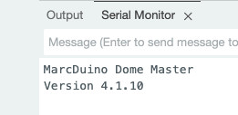
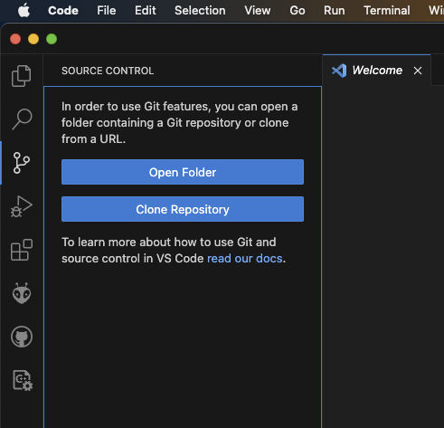
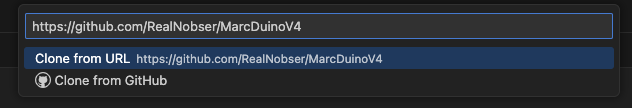
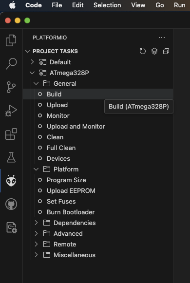
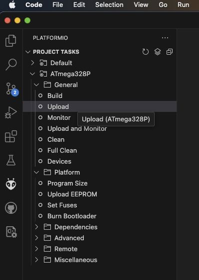
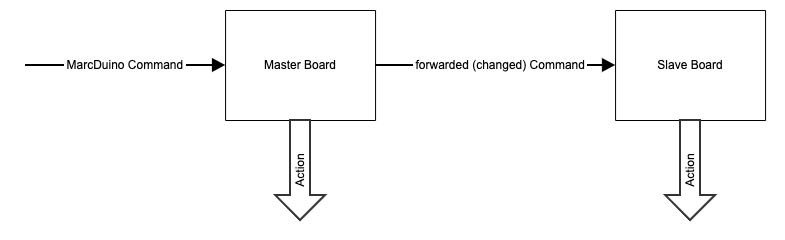

# BetterDuino Firmware V4

**English** | [Deutsch](README.de.md)

## What is the MarcDuino system?
(from https://www.curiousmarc.com/r2-d2/marcduino-system):

"The MarcDuino system controls the animatronics of an R2 (dome panels, light and sound). It currently controls 10 dome panels, an "MP3 Trigger" sound board, dome "Teeces" lights and holoprojectors light and movements, and I2C gizmos you can add-in yourself. It has lots of pre-programmed effects making all these act together.

The system is centered around the MarcDuino boards which sit in the R2. There are two kinds, the Master and the Slave board, which are very similar to each other." - CuriousMarc

## What is BetterDuino Firmware V4?
The BetterDuinoFirmwareV4 software is a **firmware replacement** for the original MarcDuino V1.5Rev3 boards.

Details about the **boards** can be found here:

https://www.curiousmarc.com/r2-d2/marcduino-system/marcduino-boards/marcduino-v1-5

https://astromech.net/forums/showthread.php?28414-Support-Thread-for-MarcDuino-v1-5-s

The **original firmware** can be found here:

https://www.curiousmarc.com/r2-d2/marcduino-system/marcduino-software-reference

There also is a **spinoff** of Marc's firmware also known as **MarcDuinoMain V3** and **MarcDuinoClient V3**:

https://github.com/nhutchison/MarcDuinoMain

https://github.com/nhutchison/MarcDuinoClient

## Important Disclaimer
***BetterDuinoFirmwareV4 has nothing to do with the original firmware made by Marc nor with the spinoff made by Neil! So if you have any questions about BetterDuino Firmware V4 don't ask any of them!***

***If you find any issues, please use the GitHub "Issues" mechanism above. When you are an experienced software developer please feel free to submit pull requests. This is a living repository and I appreciate any community input!***

If there are still questions not answered here, feel free to visit Michael Baddeley's fantastic Printed Droid community here: https://www.facebook.com/groups/MrBaddeley . You will be treated in a fair and polite way and we will find a solution or answer to your questions!

*Update:* Now there also is a BetterDuino support thread on Astromech.net: https://astromech.net/forums/showthread.php?44309-MarcDuino-Replacement-Firmware

Nevertheless: Read and understand how the boards work, why there is a master and a slave board, and how the boards are connected:

https://www.curiousmarc.com/r2-d2/marcduino-system

https://astromech.net/forums/showthread.php?28414-Support-Thread-for-MarcDuino-v1-5-s

As soon as you are familiar with MarcDuino, come back here and proceed!

## Why a Replacement Firmware for MarcDuino boards?
The last update to the original firmware was in 2018. Neil's last update was a minor change in mid-2022. His V3 software has about 80% of the original source in common, adding some features for the latest MarcDuino boards (servo controllers and EXT/AUX pin controllers). He also added the nice feature of saving settings to EEPROM at runtime. But the code also has some glitches and bugs and is based on outdated Arduino libraries. I started in 2023, after the whole Arduino framework and community had made really great progress in the previous 5 years.

The BetterDuino Firmware V4 code has completely been rewritten from scratch. I took Neil's idea of the EEPROM storage a step further, so nearly ***any*** setting is stored there, including per-servo position and speed settings. I also added the new panel animation of Tim Hebel who is also using a modified MarcDuino V3 firmware (https://github.com/Eebel/SHADOW_MD_EEBEL).

### New Features (excerpt)
- Support for MP3 Trigger, DF Mini Player, DY Player and R2-D2 / Astromech Vocalizer (https://humancyborgrelations.com/)
- Identical firmware for Master, Slave and Body
- Automatic configuration of Master and Slave at first startup
- Per-servo runtime settings for open/close positions and speed
- Modern OOP software design and use of the most recent common Arduino libraries
- I2C slave mode: every command can also be sent via I2C
- Support for R2-D2, Chopper (C1-10P) and BT-1
- Automated test suite and Wokwi simulation (see [Development](#development))
- Fixed a lot of bugs, at least of the V3 spinoff

## Let's get started
### Revision History
| Date | Rev | Firmware | Description |
|--|--|--|--|
| unreleased | main branch | 4.4.6 (dev) | Bugfixes from a security/robustness review, per-servo speed for `:OP`/`:CL`, holo move commands, leaner sound module code (~700 bytes flash and ~160 bytes RAM saved), test suite and Wokwi simulation. See [Current development state](#current-development-state-main-branch-unreleased) |
| 2025-08-10 | V1.4.5 | 4.4.5 | Configurable serial echo (`#EC`) for R2 Touch compatibility, DY player included in standard release, memory optimizations |
| 2025-05-13 | V1.4.4 | 4.4.4 | Multiple bugfixes in sound and sequence handling, fixed issue #9, DY player as option, memory optimizations |
| 2025-05-01 | V1.4.2 | 4.4.2 | Improved servo initialization |
| 2025-05-01 | V1.4.1 | 4.4.1 | Hotfix: unwanted client servo pulse |
| 2025-04-29 | V1.4.0 | 4.4.0 | Improved servo handling and bugfixing |
| 2025-01-19 | V1.3.0 | | Support for Tiny MK4 Baddeley Dome Panels, support for multiple body modules |
| 2024-07-19 | V1.2.0 | | New architecture, additional BT-1 sequences |
| 2024-04-05 | V1.0.12 | | Additional BT-1 sequence |
| 2024-04-04 | V1.0.11 | | Sound hotfix |
| 2024-04-03 | V1.0.10 | | Random sound fixes, BT-1 sequence |
| 2024-03-20 | V1.0.9 | | EEPROM protection, brownout setting |
| 2024-03-20 | V1.0.8 | | Added dome lift integration |
| 2024-03-17 | V1.0.7 | | Removed R2Touch keepalives, fixed DFMini command sequences |
| 2024-03-09 | V1.0.6 | | NeoPixelHolo configuration |
| 2024-03-08 | V1.0.5 | | NeoPixelHolo integration, bugfix servo 12/13 |
| 2024-01-30 | V1.0.4 | | First Chopper integration |
| 2024-01-17 | V1.0.3 | | Added free panel positioning to panel sequences 0% = closed / 100% = open |
| 2024-01-15 | V1.0.2 | | Bugfix release |
| 2024-01-13 | V1.0.1 | | Classic Master I2C and new I2C slave mode |
| 2023-12-30 | V1.0.0 | | First stable public version |
| 2023-12-11 | V0.9.1 RC | | Bugfixes from closed beta test group |
| 2023-10-23 | V0.9.0 RC1 | | First version for closed beta test group |

### Current development state (main branch, unreleased)
> The `main` branch is the development state. **For your droid, please use an official release:** https://github.com/RealNobser/BetterDuinoFirmwareV4/releases

Changes since V1.4.5:

**Bugfixes (crashes and memory safety)**
- `:MV00` crashed Dome Master and Body Master (null pointer). On the Dome Slave, `:MV00`…`:MV11` crashed as well (the slave only has panels 12/13).
- `*MV00` / `*MH00` (holo move with holo number 0) crashed the Dome Slave.
- Commands longer than 21 characters overflowed an internal buffer (stack overflow).
- If a line was longer than the input buffer (23 characters), its remainder was executed as a separate command (e.g. a hidden `#RS01` factory reset inside a long display text). The remainder of an overlong line is now discarded.
- Sequence completion callbacks: wrong array index when clearing.
- Sequence servo speed was uninitialized after a soft reset (panels could move with random speed).
- `#HX00…` overwrote the NeoPixel setting of holo 3.
- Long timers overflowed: `*MO`/`*MF` above 32 s, `:EO`/`*EO` above 65 s.
- Invalid sound banks/numbers (e.g. `$0`, `$999`) played unrelated tracks; they are now ignored.
- After sequences without panel movement (e.g. `:SE15`) the servo buzz protection stayed off until the next panel sequence.
- RGB holo builds: missing checks when a holo is configured as standard LED or when there is not enough RAM for the NeoPixel buffer.

**Behaviour changes**
- **I2C slave mode actually works now.** Before, received I2C data was silently dropped (no receive handler was registered).
- `INCLUDE_HOLO_RGB` (NeoPixel build) now also disables the I2C slave mode (flash size, like `INCLUDE_CLASSIC_I2C_SUPPORT`).
- `:OP`/`:CL` use the per-servo speed stored with `#SP` (factory default 0 = full speed, i.e. unchanged behaviour unless you configured a speed). Sequences using speed mode "custom" also use it.
- New holo commands `*MHxxdddd` / `*MVxxdddd` (move holo horizontally / vertically).

**Memory**
- The sound module code (MP3 Trigger, DF-Player, DY-Player, Vocalizer) was restructured into a single class without virtual functions: about 700 bytes less flash and about 160 bytes less RAM, with identical serial protocols.
- Build flag `-mcall-prologues`: about 1.2 KB less flash.
- All bugfixes together cost almost no flash; the NeoPixel build is about 2 KB smaller in total (sound restructuring plus the I2C slave mode no longer being included there).

**Development**
- Native unit test suite (`pio test -e native`) and Wokwi simulation for all three board roles, see [Development](#development).

### Known MISSING functionality compared to the original source
- RC-IN support (`:RC`, `:HD` panel commands and `*RC` holo command are not implemented)

### Known ISSUES
- MP3-Trigger: stopping only pauses, workaround pending (playing an empty sound file).
- Non-numeric parameters are interpreted as 0, which usually means "all" (e.g. `:OPxx` opens all panels). This is the same behaviour as in the original MarcDuino firmware.
- DF-Player and DY-Player commands block the board for about 100 ms each (required pause between commands of these modules).
- Every setup command (`#...`) writes to EEPROM immediately. Avoid sending setup commands in a loop (EEPROM endurance is about 100,000 write cycles per cell).

### Supported Boards
|Board|Support|Remark|
|--|--|--|
|MarcDuino V1.5 Rev3|YES||
|MarcDuino V1.5 Rev2|YES|Servo 11 = Master AUX2<br>Servo 12 = Slave ML<br>Servo 13 = Slave AUX2<br>Magic Panel = Slave "To Slave"|
|Printed Droid AIO2.0|YES|Servo 11 = Master A2<br>Servo 12 = Slave ML<br>Servo 13 = Slave A2<br>Magic Panel = Slave2|
|Printed Droid BenDuino boards (https://www.printed-droid.com/kb/benduino-system/) | not yet, but planned, tests pending||
|MarcDuino V1 | **NO** ||
|MarcDuino V2 | **NO** ||

### Compatibility Matrix
|Master/Slave|1.8|3.x|4.x|
|--|--|--|--|
|1.8|YES|YES|YES|
|3.x|YES|YES|YES|
|4.x|YES|YES|YES|

### Uploading firmware using *.hex files
- Download the latest hex files from the GitHub repository: https://github.com/RealNobser/BetterDuinoFirmwareV4/releases

	|File|Content|
	|--|--|
	|BetterDuinoVxxx.hex|Master, Slave (Client) and Body. I2C slave mode. Dome lift port is Master TX.|
	|BetterDuinoVxxx_DL_AUX.hex|Master, Slave (Client) and Body. Dome lift port is Master AUX instead of Master TX.|
	|BetterDuinoVxxx_Master+Client_ClassicI2C.hex|Master and Slave (Client), classic I2C master mode. No dome lift support.|
	|BetterDuinoVxxx_NeoPixel.hex|Master and Slave (Client). NeoPixel support for holo lights.|

	Prebuilt files are R2-D2 only; ask for other prebuilt hex binaries.
- Flash the hex file with the following fuse settings (**incorrect fuse settings will lead to non-functional boards or unintended EEPROM content reset!**):

	* L: 0xFF
	* H: 0xD7
	* E: 0xFC

- **Recommended:** When not using the Arduino IDE take a look at avrdude
	* avrdude: https://github.com/MCUdude/avrdude
	* GUI for avrdude: https://blog.zakkemble.net/avrdudess-a-gui-for-avrdude/
	* some instructions: https://forum.arduino.cc/t/the-simplest-way-to-upload-a-compiled-hex-file-without-the-ide/401996

### Assigning Roles
The same BetterDuino firmware is used for MarcDuino Master, Slave and Body Master. For newly flashed MarcDuinos to know their role, you have to assign it to each one.

To do so, establish a serial monitor connection to the newly flashed MarcDuino. You can use the serial monitor built into the Arduino IDE or add the [Serial Monitor Extension](https://marketplace.visualstudio.com/items?itemName=ms-vscode.vscode-serial-monitor) to Visual Studio Code.

Set the baud rate to 9600. Commands must be terminated with a carriage return (CR, `\r`).

When connecting via the serial terminal, you should be welcomed with a message similar to



To assign the role, enter one of the following commands:

* `#MD00` for MarcDuino Dome Master
* `#MD01` for MarcDuino Dome Slave
* `#MD02` for MarcDuino Body Master

The MarcDuino reboots immediately and starts up in the new mode.

**Hint:** The default after a factory reset is MarcDuino Dome Master. A board connected to the slave port of the MarcDuino Master is automatically configured as Dome Slave. A Body Master has to be configured either manually or by an additional startup command `#MD02`, sent only to the body controller.

## Development
### Development Environment
* Visual Studio Code: https://code.visualstudio.com/download
* PlatformIO Extension: https://platformio.org/install/ide?install=vscode
* Recommended ISP programmers:
	* https://www.diamex.de/dxshop/USB-ISP-Programmer-fuer-AVR-STM32-LPC-ESP32-8266-Prog-S
	* https://www.diamex.de/dxshop/USB-ISP-Programmer-fuer-Atmel-AVR

### Building and uploading firmware using Visual Studio Code
- Clone the GitHub repository using Visual Studio Code (Source Control / Clone Repository)
- 
- 
- Open the local folder
- Edit the file "platformio.ini" to match the serial port of your programmer:
`upload_port = /dev/cu.usbmodem141201` (example)
- Build the code (PlatformIO / ATmega328P / General / Build)
- 
- Upload the code (PlatformIO / ATmega328P / General / Upload)
- 

In VS Code the PlatformIO **Build** button builds the firmware (default environment `ATmega328P`). The `native*` environments in the PlatformIO sidebar are only used for the unit tests.

From the command line:

```sh
pio run                      # build firmware (.pio/build/ATmega328P/firmware.hex)
pio run -t upload            # flash via ISP programmer (also sets the fuses)
```

**Flash and RAM are nearly exhausted** (32 KB flash, 2 KB RAM on the ATmega328P). The release builds use PlatformIO's default AVR toolchain (GCC 7.3). Newer compilers generate noticeably larger code (GCC 9.5: about +1.2 KB). The build uses `-mcall-prologues` (see `platformio.ini`), which saves about 1.2 KB, so the combined firmware also fits with newer compilers (GCC 9.5: 31,914 of 32,768 bytes). On Apple Silicon Macs without Rosetta, PlatformIO's AVR toolchain does not run; a native avr-gcc (e.g. Homebrew `osx-cross/avr`) can be used instead.

### Tests
The firmware sources are compiled unchanged against Arduino mocks and run on the host computer, with AddressSanitizer and UndefinedBehaviorSanitizer. No hardware and no AVR toolchain are needed.

```sh
pio test -e native                   # R2-D2
pio test -e native_chopper           # Chopper
pio test -e native_bt1               # BT-1
pio test -e native -f test_parser    # single test suite
```

The native tests need a host C++ compiler with sanitizer support (clang on macOS, gcc/clang on Linux). On Windows, run them in WSL; the firmware build is not affected.

The suites cover command parsing, the serial and I2C input path, EEPROM storage and all setup commands, the sequencer, Dome Master / Dome Slave / Body Master behaviour, all four sound module protocols, exhaustive command sweeps, random fuzzing and all sequence numbers 0–99.

### Wokwi simulation
`sim/` contains one [Wokwi](https://wokwi.com) project per board role (Dome Master, Dome Slave, Body Master) with servos, LEDs and a logic analyzer, plus automated scenarios that run the real AVR firmware. See [sim/README.md](sim/README.md).

```sh
pio run
export WOKWI_CLI_TOKEN=...           # https://wokwi.com/dashboard/ci
sim/run_scenarios.sh
```

### Compiler defines in include/config.h
Normally you do not need to change the defines, but, for experienced users, some instructions:
|Define|Function|Remark|Default|
|--|--|--|--|
|R2D2|build standard R2D2 MarcDuino compatible firmware|Only choose one: R2D2, CHOPPER or BT1|on|
|CHOPPER|build Chopper compatible firmware|Only choose one: R2D2, CHOPPER or BT1|off|
|BT1|build BT-1 compatible firmware|Only choose one: R2D2, CHOPPER or BT1|off|
|INCLUDE_DOME_MASTER / INCLUDE_DOME_SLAVE / INCLUDE_BODY_MASTER|roles included in the combined firmware|disable roles you do not need to save flash memory|on|
|DEBUG_MSG|activate additional debug messages on the USB/Serial-Port|program size will exceed, disable unused roles to make room|off|
|INCLUDE_CLASSIC_I2C_SUPPORT|activate support for the classic MarcDuino I2C commands|disables Body Master role and new I2C slave mode (flash size)|off|
|INCLUDE_I2C_SLAVE|activate support for the new I2C slave mode|automatically disabled by INCLUDE_CLASSIC_I2C_SUPPORT and INCLUDE_HOLO_RGB (flash size)|on|
|INCLUDE_HOLO_RGB|NeoPixel holoprojectors|disables Body Master role and I2C slave mode (flash size), choose ARDUINO_NEOPIXEL or FASTLED_NEOPIXEL|off|
|SEPARATE_DOMELIFT|use (Master) AUX as separate Dome Lift serial||off|
|INCLUDE_DY_PLAYER|support DY-SV5W sound module|replaces DF-Player support|on|
|INCLUDE_HOLO_TEST|holo movement test command `*TExx`|for setting up holo servos (~370 bytes flash)|on|

***Do not touch any other of the defines.***

Connecting Servos R2D2 (common way)
=================
# Master
| **Servo** | **Function** | **Remark** |
| --- | --- | --- |
|Servo 1|Panel 1|Lower Panel|
|Servo 2|Panel 2|Lower Panel|
|Servo 3|Panel 3|Lower Panel|
|Servo 4|Panel 4|Lower Panel|
|Servo 5|Panel 5|Lower Panel|
|Servo 6|Panel 6|Lower Panel|
|Servo 7|Panel 7|Upper Panel|
|Servo 8|Panel 8|Upper Panel|
|Servo 9|Panel 9|Upper Panel|
|Servo 10|Panel 10|Upper Panel|
|Servo 11|Panel 11|Circular Top Panel|
|AUX|unused||
# Slave
| **Servo** | **Function** | **Remark** |
| --- | --- | --- |
|Servo 1|Front Holo, V-Servo||
|Servo 2|Front Holo, H-Servo||
|Servo 3|Rear Holo, V-Servo||
|Servo 4|Rear Holo, H-Servo||
|Servo 5|Top Holo, V-Servo||
|Servo 6|Top Holo, H-Servo||
|Servo 7|Front Holo Light||
|Servo 8|Rear Holo Light||
|Servo 9|Top Holo Light||
|Servo 10=12|Tiny1|Tiny Lower Panel 1, Michael Baddeley Complex Dome MK4 only, controlled as Servo 12 via Master|
|Servo 11=13|Tiny2|Tiny Lower Panel 2, Michael Baddeley Complex Dome MK4 only, controlled as Servo 13 via Master|
|AUX|unused||
# Body
| **Servo** | **Function** | **Remark** |
| --- | --- | --- |
|Servo 1|DPL - DataPanel Door||
|Servo 2|UtlArmU - Upper Utility Arm||
|Servo 3|UtlArmL - Lower Utility Arm||
|Servo 4|LBdyDr - Left BreadPan Door||
|Servo 5|LArm - Left Arm Raise/Lower||
|Servo 6|LArmTool - Left Arm Tool||
|Servo 7|ToolRBdyDr - Right BreadPan Door||
|Servo 8|RArm - Right Arm Raise/Lower||
|Servo 9|RArmTool - Right Arm Tool||
|Servo 10|unused|Future Charge Bay Door servo|
|Servo 11|unused||
|AUX|unused||

Connecting Servos Chopper (WIP)
=================
# Master
| **Servo** | **Function** | **Remark** |
| --- | --- | --- |
|Servo 1|Left Dome Door||
|Servo 2|Left Dome Arm||
|Servo 3|Left Dome Gripper||
|Servo 4|Left Dome Arm Turn|Tim Hebel Mod|
|Servo 5|Right Dome Door||
|Servo 6|Right Dome Arm||
|Servo 7|Right Dome Gripper||
|Servo 8|Right Dome Arm Turn|Tim Hebel Mod|
|Servo 9|Periscope Lift||
|Servo 10|Periscope Turn||
|Servo 11|unused||
|AUX|Activate Camera||

# Slave
| **Servo** | **Function** | **Remark** |
| --- | --- | --- |
|Servo 1|||
|Servo 2|||
|Servo 3|||
|Servo 4|||
|Servo 5|||
|Servo 6|||
|Servo 7|||
|Servo 8|||
|Servo 9|Periscope LED?||
|Servo 10=12|Turn Antenna|Controlled as Servo 12 via Master|
|Servo 11=13|Tilt Antenna|Controlled as Servo 13 via Master|
|AUX|unused||

# Body
| **Servo** | **Function** | **Remark** |
| --- | --- | --- |
|Servo 1|Dome Tilt||
|Servo 2|Utility Arm||
|Servo 3|Utility Arm Gripper||
|Servo 4|Saw Door||
|Servo 5|Saw Arm||
|Servo 6|Saw Motor||
|Servo 7|Interface Door||
|Servo 8|Interface Arm||
|Servo 9|Interface Action||
|Servo 10|||
|Servo 11|||
|AUX|||

Connecting Servos BT1
=================
# Master
| **Servo** | **Function** | **Remark** |
| --- | --- | --- |
|Servo 1|Launcher 1|Left Launcher Panel|
|Servo 2|Launcher 2|Right Launcher Panel|
|Servo 3|Rockets 1|Left Rockets Firing|
|Servo 4|Rockets 2|Right Rockets Firing|
|Servo 5|unused||
|Servo 6|unused||
|Servo 7|unused||
|Servo 8|unused||
|Servo 9|unused||
|Servo 10|unused||
|Servo 11|unused||
|AUX|unused||
# Slave
| **Servo** | **Function** | **Remark** |
| --- | --- | --- |
|Servo 1|Front Holo, V-Servo||
|Servo 2|Front Holo, H-Servo||
|Servo 3|unused||
|Servo 4|unused||
|Servo 5|unused||
|Servo 6|unused||
|Servo 7|Front Holo Light||
|Servo 8|unused||
|Servo 9|unused||
|Servo 10=12|unused|Controlled as Servo 12 via Master|
|Servo 11=13|unused|Controlled as Servo 13 via Master|
|AUX|unused||
# Body
| **Servo** | **Function** | **Remark** |
| --- | --- | --- |
|Servo 1|DPL - DataPanel Door||
|Servo 2|UtlArmU - Upper Utility Arm||
|Servo 3|UtlArmL - Lower Utility Arm||
|Servo 4|LBdyDr - Left BreadPan Door||
|Servo 5|LArm - Left Arm Raise/Lower||
|Servo 6|LArmTool - Left Arm Tool||
|Servo 7|ToolRBdyDr - Right BreadPan Door||
|Servo 8|RArm - Right Arm Raise/Lower||
|Servo 9|RArmTool - Right Arm Tool||
|Servo 10|Charge Bay Door||
|Servo 11|unused||
|AUX|unused||

MarcDuino Command Set (V4 only)
===============================

Unsupported original MarcDuino features
=======================================

· no Panel/Servo RC_IN support

· some configuration commands are not supported / necessary due to cleaned command processing / storage

Commands
========

Routing
-------

All commands are sent to the master board. The slave board is always connected to the master board. Slave boards are not running in stand-alone mode. So the master board decides what to do with the commands. It might process or even omit the command.



Format
------

Every command starts with one of the special start characters below and is terminated with a carriage return (`\r`). A command line can be at most 23 characters long (plus `\r`); the remainder of a longer line is discarded. Line feeds (`\n`) are ignored.

Command processing
------------------

| **Start Cmd** | **Function** | **Master process** | **Master Interface** | **Slave process** | **Slave Interface** | **Remark** |
| --- | --- | --- | --- | --- | --- | --- |
| :   | Pie panel commands | PROCESSED<br><br>FORWARDED TO SLAVE P12/P13 | Servos<br><br>Serial_Slave | PROCESSED | Servos | Slave is only responsible for panel 12/13 |
| *   | Holo Projector (HP) commands | NOT PROCESSED<br><br>FORWARDED TO SLAVE | Serial_Slave | PROCESSED | Servos |     |
| @   | Display commands | NOT PROCESSED<br><br>FORWARDED TO SLAVE | Serial_Slave | PROCESSED | Serial_Teeces |     |
| $   | Sound commands | PROCESSED<br><br>NOT FORWARDED | Serial_MP3 | NOT AVAILABLE | -   |     |
| ! (Master) | Alt1 alternate sound commands, passed to Serial_MP3 after stripping start command character | PROCESSED<br><br>NOT FORWARDED | Serial_MP3 | NOT AVAILABLE | -   |     |
| ! (Slave) | Alt1 alternate display commands, passed to Serial_Teeces after stripping start command character | -   | -   | PROCESSED | Serial_Teeces | In normal use the Master MarcDuino catches these, so we don't see them |
| %   | Alt2 alternate Holo Projector board commands, passed to Serial_Slave without stripping start command character | NOT PROCESSED<br><br>FORWARDED TO SLAVE | Serial_Slave | PROCESSED | Serial_Magic | Slave strips the start character |
| #   | Setup Commands | PROCESSED<br><br>FORWARDED TO SLAVE | EEPROM<br><br>Serial_Slave | PROCESSED | EEPROM | #MDxx command (MarcDuino mode) will not be forwarded to slave |
| &   | I2C-Commands (classic I2C build only) | PROCESSED<br><br>FORWARDED TO SLAVE | I2C<br><br>Serial_Slave | PROCESSED | I2C |     |
| >   | Raw forward to slave | NOT PROCESSED<br><br>FORWARDED TO SLAVE WITHOUT START CHARACTER | Serial_Slave | - | - | e.g. `>:OP12` |

Panel Commands
--------------

They must follow the syntax ":CCxx\\r" where CC=command, xx= two digit decimal number, \\r is carriage return.

`:OP`, `:CL` and `:MV` move with the per-servo speed stored with `#SP` (default 0 = full speed).

| **Command** | **Function** | **Master** | **Slave** | **Remark** |
| --- | --- | --- | --- | --- |
| :SExx | launches sequences, see below | YES | YES |     |
| :OPxx | open panel number xx=01-13. If xx=00, opens all panels (12/13 Slave only) | YES | YES |     |
| :OP14 | open top panels (7-11) | YES | NO  |  |
| :OP15 | open bottom panels (1-6) | YES | NO  |  |
| :CLxx | close panel number xx=01-13. If xx=00, closes all panels | YES | YES | :CL14 / :CL15 close top / bottom panels |
| :LKxx | lock panel number xx=01-13, lock current position to avoid problems with DomeLift. If xx=00, locks all panels (12/13 Slave only) | YES | YES |     |
| :ULxx | unlock panel number xx=01-13, unlocks panel, normal mode. If xx=00, unlocks all panels (12/13 Slave only) | YES | YES |     |
| :LIxx | dome lift command xx, forwarded to the dome lift serial port. See [Dome Lift](#connection-dome-lift-to-marcduino-boards) | YES | NO  |     |
| :STxx | buzz kill/soft hold: shuts servo xx off to eliminate buzz. xx=00 all servos off. | YES | YES |     |
| :MVxxdddd | move panel xx=01-13 to position dddd, dddd=0000-0180 deg, dddd > 0544 microseconds. Does not store the position. | YES | YES | Use for panel adjustment, see below |
| :EOxx | AUX1 output, see [Special Features](#special-features) | YES | YES |     |
| :RCxx / :HDxx | RC control / RC hold | NO | NO | not implemented (no RC-IN support) |

Sequence Command Details
------------------------

See panel sequence matrices defined in include/PanelSequences.h (R2-D2 numbering, Chopper and BT-1 use their own sequences).

| **Command** | **Function** | **Remark** |
| --- | --- | --- |
|     | **Full (Move, Sound, Display…)** |     |
| :SE00 | Close all panels, servo off - use as init only. Use CL00 for all soft close. | Played at startup if `#SI01` (default) |
| :SE01 | Scream, with all panels open |     |
| :SE02 | Wave, one panel at a time |     |
| :SE03 | Fast (Smirk) back and forth wave |     |
| :SE04 | Wave 2 (open progressively all panels, then close one by one) |     |
| :SE05 | Beep Cantina (with marching ants panel action) |     |
| :SE06 | Faint/Short Circuit |     |
| :SE07 | Cantina dance (orchestral, rhythmic panel dance) |     |
| :SE08 | Leia |     |
| :SE09 | Disco | about 6.5 minutes |
| :SE10 | Quiet Mode reset (panel close, stop holos, stop sounds) |     |
| :SE11 | Full Awake Mode reset (panel close, random sound, holo movement, no holo lights) |     |
| :SE12 | Top Panels to RC | no RC-IN support |
| :SE13 | Mid Awake Mode reset (panel close, random sound, stop holos) |     |
| :SE14 | Awake+ Mode reset (panel close, random sound, holo movement, lights on) |     |
| :SE15 | Screams no panels |     |
| :SE16 | Panel Wiggle |     |
|     | **Body Sequences (Tim Hebel)** |     |
| :SE30 | Utility ARM open and close sequence |     |
| :SE31 | All Body Panels open and close sequence |     |
| :SE32 | All Body Doors open and wiggle close sequence |     |
| :SE33 | Body - Use Gripper |     |
| :SE34 | Body - Use Interface Tool |     |
| :SE35 | Body - Ping Pong Body Doors |     |
| :SE36 | Body - BT-1 Two gripper Sequence | Thanks to David Steinke  |
|     | **Move Panels only** |     |
| :SE51 | Scream, with all panels open |     |
| :SE52 | Wave, one panel at a time |     |
| :SE53 | Fast (Smirk) back and forth wave |     |
| :SE54 | Wave 2 (open progressively all panels, then close one by one) |     |
| :SE55 | Marching ants |     |
| :SE56 | Faint/Short Circuit |     |
| :SE57 | Rhythmic panel dance |     |
| :SE58 | Panel Wave Bye Bye |     |

Holo Projector Commands
-----------------------

These commands are only processed by the MarcDuino Slave module.

| **Command** | **Function** | **Remark** |
| --- | --- | --- |
| *RDxx | Random Holo movement (xx=01 to 03). xx=00 and >3 all random. |     |
| *ONxx | Turns Holo Light on (xx=01 to 03). xx=00 all lights on |     |
| *OFxx | Turns Holo Lights off (xx=01 to 03). xx=00 turns all lights off |     |
| *ONxxaaabbbcccddd | Turns RGB Holo Light on (xx=01 to 03). xx=00 all lights on.<br>aaa - decimal R value (0-255)<br>bbb - decimal G value (0-255)<br>ccc - decimal B value(0-255)<br>ddd - brightness (0-255) | NeoPixel build only |
| *COxxaaabbbcccddd | Sets color for RGB Holo Light (xx=01 to 03).<br>aaa - decimal R value (0-255)<br>bbb - decimal G value (0-255)<br>ccc - decimal B value(0-255)<br>ddd - brightness (0-255) | NeoPixel build only |
| *MHxxdddd | Move holo xx=01-03 horizontally to position dddd (0000-0180 deg, > 0544 microseconds) | New |
| *MVxxdddd | Move holo xx=01-03 vertically to position dddd (0000-0180 deg, > 0544 microseconds) | New |
| *TExx | Holo movement test (xx=01-03). Goes through a loop of holo movements to assist in adjusting the holo servos' mechanical setup. | only with INCLUDE_HOLO_TEST |
| *STxx | stop/reset Holos random movement, turns lights off. 00=all off |     |
| *HDxx | hold: stop holo, do not change light level. 00=all stopped |     |
| *MOxx | magic panel on. xx=01 to 98, on from 1 to 98 seconds.<br><br>· xx = 99 is on permanently<br><br>· xx = 00 is off |     |
| *MFxx | magic panel flicker xx=1 to 99 flicker for 1 to 99 seconds. 00= off. |     |
| *H1xx<br><br>*H2xx<br><br>*H3xx<br><br>*H0xx | Will turn on-board HP1, 2, 3, and all (HP0xx) for xx seconds.<br><br>· xx = 99 is on permanently<br><br>· xx = 00 is off |     |
| *Hzxxaaabbbcccddd | See "*H0"-"*H3"<br>aaa - decimal R value (0-255)<br>bbb - decimal G value (0-255)<br>ccc - decimal B value(0-255)<br>ddd - brightness (0-255)| NeoPixel build only |
| *F1xx<br><br>*F2xx<br><br>*F3xx<br><br>*F0xx | Will flicker on-board HP1, 2, 3, and all (F0xx) for xx seconds.<br><br>· xx = 99 is on permanently<br><br>· xx = 00 is off |     |
| *Fzxxaaabbbcccddd | See "*F0"-"*F3"<br>aaa - decimal R value (0-255)<br>bbb - decimal G value (0-255)<br>ccc - decimal B value(0-255)<br>ddd - brightness (0-255) | NeoPixel build only |
| *CHxx | Center Holo Nr xx (01-03), xx=00 all |     |
| *EOxx | AUX1 output on the slave, see [Special Features](#special-features) |     |
| *RCxx | Holo under RC control | not implemented (no RC-IN support) |

Sound Commands
--------------

These commands are only processed by the MarcDuino Master module.

| **Command** | **Function** | **Remark** |
| --- | --- | --- |
| $xyy | Play sound by bank/sound number<br><br>· x=bank number (1-9)<br><br>· yy=sound number (01-25) | Invalid bank/sound numbers are ignored |
| $xy | Play sound by bank/sound number, short version<br><br>· x=bank number (1-9)<br><br>· y=sound number (1-9) |     |
| $x | Play next sound of bank x (1-9) |     |
| $R  | random sounds from banks 1-5 |     |
| $O  | sound off |     |
| $L  | Leia message (bank 7 sound 1) |     |
| $C  | Cantina music (bank 9 sound 5) |     |
| $c  | Beep cantina (bank 9 sound 1) |     |
| $S  | Scream (bank 6 sound 1) |     |
| $F  | Faint/Short Circuit (bank 6 sound 3) |     |
| $D  | Disco (bank 9 sound 6) |     |
| $s  | stop sounds |     |
| $+  | volume up |     |
| $-  | volume down |     |
| $m  | volume mid |     |
| $f  | volume max |     |
| $p  | volume min |     |
| $W  | Star Wars music (bank 9 sound 2) |     |
| $w  | Beep Star Wars music (bank 9 sound 7) |     |
| $M  | Imperial March (bank 9 sound 3) |     |
| $i  | Beep Imperial March (bank 9 sound 8) |     |
| $B  | Startup Sound |     |

Special Features
----------------

| **Command** | **Function** | **Remark** |
| --- | --- | --- |
| :EOxx | Pull pin high/low on AUX1. Can be used to trigger a smoke machine as an example.<br><br>xx is the time in seconds.<br><br>· 00 - off<br><br>· 01-98 is the time in seconds (don't use values >10 for smoke machines!)<br><br>· 99 on permanently (again don't use for smoke machines) | will be executed on MASTER only |
| *EOxx<br><br>TO SLAVE | Pull pin high/low on AUX1. Can be used to trigger a smoke machine as an example.<br><br>xx is the time in seconds.<br><br>· 00 - off<br><br>· 01-98 is the time in seconds (don't use values >10 for smoke machines!)<br><br>· 99 on permanently (again don't use for smoke machines) | will be executed on SLAVE only |

Setup Commands
--------------

All setup commands are stored in EEPROM immediately.

| **Command** | **Function** | **Remark** |
| --- | --- | --- |
|     | **Servo Controls** |     |
| #SOxxdddd | Set Servo xx Degrees/Microseconds for Panel Open, dddd=0000-0180 deg, dddd > 0544 Microseconds |     |
| #SCxxdddd | Set Servo xx Degrees/Microseconds for Panel Closed dddd=0000-0180 deg, dddd > 0544 Microseconds |     |
| #SPxxddd | Set Servo xx Speed, ddd=0-255 (0 = full speed/default, 1 = slowest ... 255 = fastest). Used by :OP, :CL, :MV and by sequences with custom speed |     |
| #SWxx | Swap Panel xx Open&lt;-&gt;Close value | Don't use as the classic "reverse servo" command. Don't call it at every boot, just use it in adjustment process. |
| #SIxx | Panel initialization at startup<br><br>· #SI00 : off<br><br>· #SI01 : play :SE00 (close all panels) at startup (default) | Master/Body |
|     | **Startup Sound Controls** |     |
| #SSxxx | Set startup sound<br><br>· #SS000 : Disable Startup Sound, and remove startup sound delay for fast boot of R2<br><br>· #SSxxx : Set Startup Sound in file xxx |     |
| #SQxx | Disable Random Sound<br><br>· #SQ00 : Random Sound on<br><br>· #SQ01 : No Random Sound + Volume off<br><br>· #SQ02 : No Random Sound |     |
| #SXxx | Set Max Random Pause in seconds - Maximum timespan between two random sounds |     |
| #SYxx | Set Min Random Pause in seconds - Minimum timespan between two random sounds |     |
|     | **System Configuration and Management** |     |
| #MDxx | Set MarcDuino Mode<br><br>· #MD00 : MarcDuino Dome Master<br><br>· #MD01 : MarcDuino Dome Slave<br><br>· #MD02 : MarcDuino Body Master<br><br>MarcDuino will reboot immediately after setup and start up in new mode. |     |
| #MPxx | Set MP3-Player Type<br><br>· #MP00 : SparkFun MP3 Trigger<br><br>· #MP01 : DFPlayer<br><br>· #MP02 : Vocalizer<br><br>· #MP03 : DY-Player | Reboots immediately |
| #MSxyy | Set maximum sounds per soundbank. x=1-9 (Soundbank), y=0-25 (max. Sounds) |     |
| #RSET<br><br>#RS01 | Restart MarcDuino<br><br>Factory Reset |     |
| #ECxx | Activate/Deactivate serial echo<br><br>· #EC00 : Serial Echo Off<br><br>· #EC01 : Serial Echo On  | Do not activate when using Dome Lift module on TX port! |
| #DMxx | Dump EEPROM value at address xx to serial | DEBUG_MSG builds only |
|     | **Holo Projector Configuration** |     |
| #HLxy | Set HoloLight x to High Active (y=1) or Low Active (y=0). x=0 → All Holo Lights | Reset board afterwards to take effect |
| #HNxy | Set HoloLight x to NeoPixel (y=1) or Standard-LED (y=0). x=0 → All Holo Lights | Reset board afterwards to take effect |
| #HXxxyy | Configure number of LEDs (yy) for HoloLight xx=01-03 | Will only be used if HoloLight xx is set to NeoPixel. Reset board afterwards to take effect |
| #HOxxdddd | Set Holo HServo Degrees/Microseconds Max, dddd=0000-0180 deg, dddd > 0544 Microseconds |     |
| #HCxxdddd | Set Holo HServo Degrees/Microseconds Min, dddd=0000-0180 deg, dddd > 0544 Microseconds |     |
| #VOxxdddd | Set Holo VServo Degrees/Microseconds Max, dddd=0000-0180 deg, dddd > 0544 Microseconds |     |
| #VCxxdddd | Set Holo VServo Degrees/Microseconds Min, dddd=0000-0180 deg, dddd > 0544 Microseconds |     |
|     | **Not implemented (from older documentation / original firmware)** |     |
| #HPxxddd / #VPxxddd | Holo servo speed | not implemented |
| #STxxx | Delay between Master and Slave panel sequence | not implemented |
| #ADxx | Adjustment mode | not implemented, use :MVxxdddd instead |
| #DUxx | Dump EEPROM | replaced by #DMxx (debug builds) |

I2C Commands (Classic, Master-Mode)
============
Only available in the classic I2C build (`INCLUDE_CLASSIC_I2C_SUPPORT`, release file `..._Master+Client_ClassicI2C.hex`).

**Source:**

https://www.curiousmarc.com/r2-d2/marcduino-system/marcduino-software-reference/marcduino-command-reference#h.p_EQOGPlR2RuOk

If you send a command following the format:

***&I2Caddress, data, data, data...**

an I2C write command will be generated on all the I2C ports in the MarcDuino chain (master and all slaves). The write command will be addressed to the device at I2Caddress and will write all the data bytes provided in order.

Data can be decimal numbers, hex bytes, characters or strings, depending on the prefix appended to the data, as follows.

Decimals need no prefix. Valid range is -128 to 255. For example, to send command 2 (decimal) to an I2C device at address 25:

***&25,2**

To send an hex byte, add x as a prefix. To send the hex byte 0xFF to device 25:

***&25,xFF***

To send a single character, use the ' prefix

***&25,'c***

To send a string, use the " prefix. Don't put another " at the end or it will be transmitted as part of the string...

***&25,"Hello World  (note: there is no second " at the end of the string)***

And of course you can mix everything:

***&25,2,xFF,'c,"Hello World***

I2C Commands (New, Slave-Mode)
==============================
MarcDuino boards with BetterDuino firmware can receive any serial command also as I2C slave via the I2C interface. So other components besides the main control system (ShadowMD etc.) are able to execute commands or start sequences (e.g. dome lift). The protocol is pretty simple: send an I2C message to one of the following slave addresses with a data payload identical to one of the commands described above. Don't forget to terminate the command with a carriage return (`\r` = 0x0D). One command per I2C transmission.

| **I2C-Address (dec/hex)** | **Type** |
| --- | --- |
|50/0x32|MarcDuino Dome Master|
|51/0x33|MarcDuino Dome Slave|
|52/0x34|MarcDuino Body Master|

I2C addresses can be changed in include/config.h if needed.

The I2C slave mode is part of the standard build (`INCLUDE_I2C_SLAVE`). It is not available in the classic I2C build and in the NeoPixel build. **Note:** up to V1.4.5 received I2C data was dropped (see [Current development state](#current-development-state-main-branch-unreleased)).


Best practice panel adjustment
==============================

- Connect a serial interface to the "XBEE/SERIAL IN" port of your board
- Open a serial terminal program and connect via 9600 Baud, 8N1, line ending CR. Activate character echo in your terminal program.
- Use the "Move Panel" (:MVxxdddd) command to get a feeling for the range the servo moves within.
- If you find a valid position for "open", store it with the command "Store Open" (#SOxxdddd)
- If you find a valid position for "closed", store it with the command "Store Closed" (#SCxxdddd)
- Optionally set a speed for the panel with #SPxxddd; it is used by :OP, :CL and :MV

*Example:*
- If you think ":MV010900" moves panel/servo #1 to a valid open position, store the setting with "#SO010900"
- If you think ":MV011750" moves panel/servo #1 to a valid closed position, store the setting with "#SC011750"
- :MVxxdddd does not store any position, it just moves the servo to the PWM/degree value

*Shortcut*
- If the default positions are fine but swapped (:OP01 closes the panel and :CL01 opens it), just use "#SW01" to swap the values for open and closed position. The values are automatically stored. Important: That command is not identical to the "Reverse Servo" command. Just use the swap command while calibrating your servos, not at every startup. Otherwise it will toggle the settings on every startup.
- Repeat all the steps until each servo is calibrated

Holo servos can be adjusted the same way with `*MHxxdddd` / `*MVxxdddd` and stored with `#HO`/`#HC`/`#VO`/`#VC`.

Connection Dome Lift to MarcDuino boards
========================================
Please use BetterDuino firmware V1.0.8 or higher.
- Connect Master InterCom-TX to Dome Lift RX0 (or Master AUX when using the `_DL_AUX` firmware / `SEPARATE_DOMELIFT`)
- Connect the I2C bus from the MarcDuino board to the Dome Lift board
- Use the modified dome lift firmware (https://github.com/RealNobser/DomeLiftMechanism/tree/main)
- The MarcDuino command is :LIxx. To be compatible with the R2Touch app the command mapping is as follows:

| **Cmd** | **Action** |
| --- | --- |
| :LI07 | Bad Motivator |
| :LI08 | Dome Zapper |
| :LI09 | Lightsaber |
| :LI10 | Life Form |
| :LI11 | Periscope |


EEPROM Memory Map
=================

All the settings of the "Setup Commands" are stored in EEPROM. The corresponding memory map is described here. Default settings after a factory reset are written in **bold** letters. Positions: values 0-180 are degrees, values ≥ 544 are microseconds. Servo/holo number 0 addresses the "global" slot of a table.

| **Address** | **Type** | **Content** | **Default** | **Description** |
| --- | --- | --- | --- | --- |
| 0x00 | byte | Config version | **41** | EEPROM layout version. If it does not match the firmware, a factory reset is performed at startup |
| 0x01 | byte | MarcDuino type | **0 = DomeMaster** | 0 = DomeMaster<br><br>1 = DomeSlave<br><br>2 = BodyMaster |
| 0x02-0x03 |     | unused |     |     |
| 0x04 | byte | MP3 player type | **0 = SparkFun MP3-Trigger** | 0 = SparkFun MP3-Trigger<br><br>1 = DF-Mini Player<br><br>2 = Vocalizer<br><br>3 = DY-Player |
| 0x05 | byte | Disable random sound | **0 = Random Sound** | 0 = Random Sound<br><br>1 = No Random Sound + Volume off<br><br>2 = No Random Sound |
| 0x06 | byte | Startup sound number | **255** | 0 = disable startup sound and remove startup sound delay for fast boot of R2 |
| 0x07-0x09 |     | unused |     |     |
| 0x0a | byte | MinRandomPause in seconds | **6** | Minimal pause between two random sounds |
| 0x0b | byte | MaxRandomPause in seconds | **12** | Maximal pause between two random sounds |
| 0x0c | byte | Serial echo | **0 = off** | 0 = off, 1 = on (#EC) |
| 0x11-0x19 | bytes | Max sounds bank 1-9 | Standard SD card layout:<br><br>**Bank 1: 19**<br>**Bank 2: 18**<br>**Bank 3: 7**<br>**Bank 4: 4**<br>**Bank 5: 3**<br>**Bank 6: 3**<br>**Bank 7: 3**<br>**Bank 8: 6**<br>**Bank 9: 8** | Number of sounds per bank, 1-25 |
| 0x31-0x3d | bytes | Servo 1-13 speed | **0 = full speed** | 0 = full speed (no limit)<br><br>1 = slowest<br><br>255 = fastest |
| 0x42-0x5b | words | Servo 1-13 open position | **1000** | Degrees / microseconds for panel open |
| 0x62-0x7b | words | Servo 1-13 closed position | **2000** | Degrees / microseconds for panel closed |
| 0x80 | byte | Panel init at startup | **1 = on** | 0 = off, 1 = play :SE00 at startup (#SI) |
| 0xb4-0xbf | words | Holo 1-3 min position, H and V servo (Holo1 H, Holo1 V, Holo2 H, …) | **1000** | Degrees / microseconds |
| 0xc4-0xcf | words | Holo 1-3 max position, H and V servo | **2000** | Degrees / microseconds |
| 0xd1-0xd3 | bytes | Holo 1-3 light high/low active | **1 = high active** | 0 = low active, 1 = high active |
| 0xd4-0xd6 | bytes | Holo 1-3 light type | **0 = standard LED** | 0 = standard LED, 1 = NeoPixel |
| 0xd7-0xd9 | bytes | Holo 1-3 number of NeoPixel LEDs | **7** |     |
| 0xe2-0xe7 | bytes | Holo 1-3 servo speed, H and V | **0** | stored, currently not used |


Used Libraries
==============

- https://github.com/nickgammon/SendOnlySoftwareSerial
- https://github.com/RealNobser/VarSpeedServo (fork of https://github.com/netlabtoolkit/VarSpeedServo)
- https://github.com/adafruit/Adafruit_NeoPixel
- https://github.com/FastLED/FastLED
